# WeAgent 技术文档

**完整技术文档**  
**代码事实基线：用户提供的 WeAgent `main` 分支归档**  
**更新日期：2026-08-07**  
**正式交付基线：Word 版本；Markdown 为同步维护副本**

> 本文面向技术评审、后续维护与工程交接。内容以当前 `main` 分支中的源码、配置、路由、模型和前端调用为主要事实来源；旧版飞书文档用于保持结构和图文表达风格，Codex 新稿仅作为候选材料。测试通过数量、一次性 UAT 数据和某个时间点的运行状态不作为长期技术事实写入正文。

## 文档目录

1. 项目与文档范围  
2. 相关技术栈  
3. 系统架构  
4. 核心模块  
5. 核心技术实现  
6. 关键数据流  
7. 开发者部署与运行  
8. 关键接口与数据模型  
9. 运行风险与常见故障  
10. 三个领域的实现  
11. 关键术语表

---
## 1. 项目与文档范围

本章定义 WeAgent 的系统定位、能力边界和技术文档范围。技术文档的重点不是介绍页面操作，而是解释系统如何组织客户端、Core 控制面、Docker Sandbox、领域服务、RAG、业务数据和运行产物。

### 1.1 WeAgent 是什么

WeAgent 是一个面向 AI 协作任务的多端 Agent 工作台。用户可以在会话中选择单个 Agent 独立执行任务，也可以由主持 Agent 组织多个 Agent 进行任务拆分、分派和汇总。任务执行过程中产生的消息、进度、工作流、代码、文件、图片、表格、HTML、差异和服务预览，会以结构化消息元素或工作区文件的形式返回客户端。

从工程实现看，WeAgent 不只是一个聊天界面，而是由以下部分共同构成：

- Web、Desktop 和 Android 三类客户端；
- 负责认证、Workspace、会话、消息、Agent、Capability 和实时事件的 Core Flask 后端；
- 负责隔离执行的 Docker Sandbox；
- 负责调用 Claude Code、Codex 和 OpenCode 的 Provider Runner；
- 智能研发、智慧教育和智慧办公三个独立领域服务；
- 为三个领域提供统一文档管理和检索能力的 RAG 服务；
- Core、领域和 RAG 各自的数据存储。

因此，WeAgent 的核心定位可以概括为：

> 以通用 Agent 会话和隔离执行能力为基础，通过 Workspace、领域服务和 RAG 范围将 AI 协作扩展到研发、教育和办公业务。

关键代码入口包括：

- Core 应用：`backend/run.py`、`backend/app/__init__.py`
- Web 客户端：`frontend/`
- Desktop 客户端：`clients/desktop/`
- Android 客户端：`clients/android/`
- Docker Sandbox：`backend/app/sandbox/`
- RD 服务：`backend/services/rd/`
- Education 服务：`backend/services/edu/`
- Office 服务：`backend/services/office/`
- RAG 服务：`backend/services/rag/`

### 1.2 项目能力范围

当前工程可以按“通用平台能力”和“领域业务能力”两层理解。

#### 1.2.1 通用平台能力

| 能力域 | 当前工程范围 |
|---|---|
| 多端客户端 | Web 是完整业务与工作台入口；Desktop 复用核心会话和产物能力；Android 承载登录、会话、Agent 和设置等移动端主流程。 |
| 单 Agent 执行 | 会话可以绑定一个目标 Agent，在独立 Sandbox 中执行任务。 |
| 多 Agent 协作 | 多 Agent 会话支持主持 Agent 进行任务规划，并由 worker Agent 执行子任务。 |
| Provider Adapter | `adapter_name` 选择 Claude Code、Codex 或 OpenCode，Provider Runner 负责屏蔽不同 CLI 的命令、环境和输出差异。 |
| Capability 系统 | Skill、Tool、MCP 和 Plugin 通过统一 Capability 模型管理版本、绑定、权限和调用记录。 |
| Docker Sandbox | 正式 Agent 会话使用独立容器，任务文件、工具、服务端口和运行状态位于容器边界内。 |
| 结构化消息与产物 | 支持进度、文件、代码、图片、表格、HTML、diff、workflow 和 service 等消息元素。 |
| Workspace | 用户可以在 RD、Education 和 Office 三个领域下创建或加入工作空间，并将会话绑定到工作空间。 |
| Domain Proxy | Core 通过 `/api/domain/<domain>/*` 代理 RD、Education、Office 和 RAG 服务。 |
| RAG | 统一管理文档、Chunk、Embedding、向量数据和检索范围，并按用户、领域和工作空间进行校验。 |

#### 1.2.2 领域业务能力

| 领域 | 独立服务 | 主要业务对象 | 当前接入方式 |
|---|---:|---|---|
| 智能研发 RD | 5101 | 项目、迭代、需求、Bug、评论、成员、仓库、分支、Review、Build | 独立 Flask 服务、Core Domain Proxy、Web 研发页面、Sandbox 服务调用 |
| 智慧教育 Education | 5102 | 课程、课时、教案、课件、资源、作业、提交、知识、测评和学情 | 独立 Flask 服务、专用会话绑定、可信工具写回、课程级 RAG、Web 教育页面 |
| 智慧办公 Office | 5103 | 组织、会议、行动项、日程、公文、模板、签收和审批 | 独立 Flask 服务、Core Domain Proxy、Web 办公页面、Sandbox 服务调用 |
| 共享 RAG | 5104 | 文档、Chunk、Embedding、检索结果和访问范围 | 独立 Flask 服务，供客户端、Core、Sandbox 和领域服务使用 |

三个领域共享 Core、Workspace、Agent、Capability、Sandbox 和 RAG 基础设施，但实现深度并不完全相同。Education 在当前代码中具有更完整的专用会话绑定、角色判断、工具授权和业务写回链路；RD 与 Office 主要通过独立领域服务、工作空间和通用服务调用机制接入。技术文档会如实描述这种差异，而不会把三个领域写成完全同构。

### 1.3 文档目标与读者

本文面向以下读者：

- 需要评审 WeAgent 架构和工程边界的技术人员；
- 接手 Core、Sandbox、领域服务或 RAG 的维护者；
- 需要扩展新领域、Agent、Capability 或 Provider 的开发者；
- 需要部署和排查系统的工程人员。

本文重点回答：

1. 系统各层的职责和通信关系；
2. 三个领域如何复用通用平台并保持数据边界；
3. Agent 如何在 Sandbox 内发现和调用服务；
4. RAG 如何管理文档并实施检索范围；
5. 业务事实、知识数据和临时执行文件分别存在哪里；
6. 后续维护时应从哪些代码入口定位问题。

### 1.4 本文档覆盖的内容

完整技术文档将覆盖：

- 技术栈与服务拓扑；
- 总体系统架构；
- Core、Sandbox、Provider、Capability、Workspace 和领域服务；
- RD、Education、Office 与 RAG 的关键实现；
- 关键数据流；
- 开发部署和环境变量；
- 关键接口与数据模型；
- 常见故障和定位顺序；
- 核心术语。

### 1.5 本文档不覆盖的内容

本文档不替代以下材料：

- 面向最终用户的产品使用手册；
- 完整 OpenAPI/Swagger 字段级接口文档；
- 完整数据库 ER 图和数据字典；
- 版本测试报告、UAT 报告和运行日志；
- 产品路线图和未实现功能说明；
- 每个前端组件的样式设计说明。

某次测试通过数量、某个时刻的端口监听结果、固定账号或固定课程数据，具有版本和环境依赖性，不作为长期技术事实写入正文。

### 1.6 技术事实边界

本文以当前 `main` 分支中的源码、配置、模型、路由、运行脚本和前端调用为依据。判断一项能力是否进入正文时，优先检查：

```text
代码或配置存在
→ 路由或模块被注册
→ 存在调用入口
→ 存在数据结构或持久化位置
```

仅存在于注释、规划文档、示例数据或未注册文件中的内容，不直接描述为当前系统能力。

### 1.7 核心术语速览

| 术语 | 最小理解 |
|---|---|
| Core | WeAgent 的通用 Flask 控制面，负责认证、Workspace、会话、消息、Agent、Capability、Socket.IO 和 Sandbox 代理。 |
| Workspace | 用户在某个领域下组织会话和业务上下文的工作空间，领域值为 `rd`、`edu` 或 `office`。 |
| Domain Service | RD、Education、Office 等独立业务服务。 |
| Domain Proxy | Core 将 `/api/domain/<domain>/*` 转发到对应领域服务的 API 网关。 |
| Agent | 在会话中承担任务的 AI 工作角色。 |
| Moderator | 多 Agent 会话中的主持 Agent，负责任务规划、分配和汇总。 |
| Provider Runner | Sandbox 内封装 Claude Code、Codex 或 OpenCode CLI 的运行器。 |
| Docker Sandbox | 隔离 Agent 执行、文件、工具和服务进程的容器环境。 |
| Capability | Skill、Tool、MCP 和 Plugin 的统一能力抽象。 |
| Service View | 某个会话或 Agent 在当前上下文中允许发现和调用的服务集合。 |
| RAG Scope | RAG 检索时由服务端确定的用户、领域、工作空间及教育角色范围。 |
| Message Element | 消息中的结构化展示单元，例如 progress、file、table、workflow 和 service。 |
| Business Fact | 已写入 Core 或领域数据库的正式业务对象，不等同于 Sandbox 中的临时文件。 |

---

## 2. 相关技术栈

本章提供 WeAgent 的技术地图。技术栈以当前依赖文件、应用入口和运行镜像为依据，只说明系统正在使用的组件，不把配置文件中尚未接入的候选组件写成现行实现。

### 2.1 Web 客户端技术

Web 是当前功能最完整的客户端，承担通用工作台和三个领域的主要业务页面。

| 技术 | 当前版本或范围 | 作用 |
|---|---:|---|
| Vue | 2.7.15 | 组件和页面框架 |
| Vue Router | 3.6.5 | 通用页面及 RD、Education、Office 路由 |
| Vuex | 3.6.2 | 客户端状态管理 |
| Element UI | 2.15.14 | 主要 UI 组件库 |
| Axios | 1.6.x | REST API 请求 |
| Socket.IO Client | 4.7.x | 会话实时状态和消息元素 |
| CodeMirror | 5.65.x | 代码和文本编辑 |
| ECharts | 5.6.x | 图表展示 |
| WangEditor | 5.1.x | 富文本编辑 |
| Vue CLI | 5.0.x | Web 开发和构建 |

关键路径：

- `frontend/package.json`
- `frontend/src/router/index.js`
- `frontend/src/views/`
- `frontend/src/components/`
- `frontend/src/api/`

Web 路由中已注册研发项目、仓库、Review、Build、教育课程与学习空间、办公文档、会议、审批、日程、组织和通知等页面，因此三个领域的完整业务入口目前以 Web 为主。

### 2.2 Desktop 客户端技术

Desktop 是独立 Electron 工程，通过用户配置的 `serverUrl` 连接外部 Core 后端，不在本地内置 Flask、MySQL 或 Docker 服务。

| 技术 | 当前版本或范围 | 作用 |
|---|---:|---|
| Electron | 29.4.6 | 桌面应用运行容器 |
| Vite | 5.2.x | 开发和构建 |
| Vue | 2.7.15 | 桌面端 UI |
| Element UI | 2.15.14 | 桌面组件 |
| Axios | 1.6.x | Core API 请求 |
| Socket.IO Client | 4.7.x | 实时会话事件 |
| electron-builder | 24.13.x | 安装包构建 |

关键路径：

- `clients/desktop/package.json`
- `clients/desktop/electron/`
- `clients/desktop/src/`

Desktop 的技术边界是通用会话和工作台客户端。领域页面是否与 Web 同步，应以 Desktop 工程中的实际路由和组件为准，不能从 Web 的页面覆盖范围直接外推。

### 2.3 Android 客户端技术

Android 使用 Capacitor 将 Vue 应用运行在 Android WebView 中，通过配置的后端地址访问 Core。

| 技术 | 当前版本或范围 | 作用 |
|---|---:|---|
| Capacitor Core / Android | 6.2.1 | Web 应用与 Android 外壳 |
| Vue | 2.7.16 | 移动端 UI |
| Vue Router | 3.6.5 | 页面路由 |
| Axios | 1.6.x | 后端请求 |
| Vite | 5.2.x | 前端构建 |
| Android Studio / Gradle | 由本机构建环境提供 | 原生工程构建与调试 |

关键路径：

- `clients/android/package.json`
- `clients/android/src/`
- Android 原生目录会在执行 `npx cap add android` 后生成；当前归档中未提交该目录。

Android 当前定位为移动端主流程客户端，不应默认认为其具有 Web 端所有领域工作台能力。

### 2.4 Core 后端技术

Core 是系统的通用控制面，默认由 `backend/run.py` 启动，默认端口为 `5002`。

| 技术 | 当前依赖 | 作用 |
|---|---:|---|
| Python | 3.10+；Sandbox 镜像使用 3.11 | 后端和容器运行语言 |
| Flask | 2.3.3 | HTTP API 和应用工厂 |
| Flask-SQLAlchemy | 3.1.1 | Core 数据模型和数据库访问 |
| Flask-Migrate | 4.0.5 | 数据库迁移支持 |
| Flask-JWT-Extended | 4.5.3 | JWT 身份认证 |
| Flask-SocketIO | 5.3.4 | 会话实时通信 |
| Flask-CORS | 4.0.0 | 跨域访问控制 |
| Marshmallow | 3.x～4.x 兼容范围 | 请求和响应 Schema |
| PyMySQL | 1.1.0 | MySQL 驱动 |
| Redis Client | 5.0.1 | Redis 连接 |
| Docker SDK for Python | 7.x | Sandbox 容器生命周期管理 |

Core 关键工程层次：

```text
backend/app/
├── controllers/     # API 路由与请求入口
├── services/        # 通用业务和执行编排
├── models/          # Core 数据模型
├── repositories/    # 数据访问封装
├── schemas/         # 请求和响应结构
├── socket/          # Socket.IO 事件
└── sandbox/         # 宿主代理、容器运行时与工具
```

Core 在 `backend/app/__init__.py` 中注册认证、会话、消息、Agent、Artifact、Capability、Workspace、灰度、Domain Proxy、Office AI 和 Sandbox 等 Blueprint。

### 2.5 Docker Sandbox 与 Agent Runtime

正式 Agent 任务不在 Core 进程中直接执行，而是在 Docker 容器内运行。Sandbox 镜像基于 `python:3.11-slim`，安装 Node.js 20，并尝试安装 Claude Code、Codex、OpenCode 和 `codex-relay`。

| 组件 | 作用 | 关键路径 |
|---|---|---|
| Sandbox Host | 创建、恢复和停止 Docker session，并代理容器 API | `backend/app/sandbox/host/` |
| Container Server | 容器内 HTTP 控制面 | `backend/app/sandbox/container/server.py` |
| Orchestrator | 管理 Agent、工具、服务、事件和工作区 | `backend/app/sandbox/container/orchestrator.py` |
| AgentRuntime | 准备 Agent 工作区、提示词和 Provider Runner | `backend/app/sandbox/container/agent.py` |
| Provider Runner | 统一不同 Provider CLI | `backend/app/sandbox/container/providers/` |
| MCP Runtime | 启动和调用 MCP Server | `backend/app/sandbox/container/mcp_runtime.py` |
| ServiceManager | 管理容器内长运行预览服务 | `backend/app/sandbox/container/service_manager.py` |
| `weagent-report` | 上报进度、结果和结构化产物 | `backend/app/sandbox/bin/weagent-report` |
| `weagent-service` | 启动和登记预览服务 | `backend/app/sandbox/bin/weagent-service` |

容器工作目录为 `/workspace`。不同 Agent 使用私有目录，能力投影和会话状态使用独立的隐藏目录。Sandbox 文件可以支持本轮和后续会话执行，但没有写入领域数据库的文件不应被视为正式业务数据。

### 2.6 Provider Adapter 技术

Provider Runner Factory 当前注册以下 Provider：

| `adapter_name` | Runner | 执行入口 |
|---|---|---|
| `claude` / `claude_code` | `ClaudeCodeRunner` | Claude Code CLI |
| `codex` | `CodexRunner` | OpenAI Codex CLI，可结合 relay 配置 |
| `opencode` | `OpenCodeRunner` | OpenCode CLI |

关键路径：

- `backend/app/sandbox/container/providers/factory.py`
- `backend/app/sandbox/container/providers/base.py`
- `backend/app/sandbox/container/providers/claude_code.py`
- `backend/app/sandbox/container/providers/codex.py`
- `backend/app/sandbox/container/providers/opencode.py`

Provider Adapter 解决“Agent 使用哪个底层执行引擎”；它与工具调用外部服务所使用的 Provider 配置不是同一个概念。

### 2.7 领域服务技术栈

RD、Education 和 Office 都是独立 Flask 服务，拥有独立应用入口和业务数据库。RD 与 Office 基于共享的 `DomainServiceBase` 建立 Flask、SQLAlchemy、JWT、CORS、Redis 和健康检查；Education 同样通过该基础类创建应用，但增加了更多专用 Blueprint 和运行策略。

| 服务 | 应用入口 | 默认端口 | 业务数据库 |
|---|---|---:|---|
| RD | `backend/services/rd/main.py` | 5101 | `weagent_rd` |
| Education | `backend/services/edu/app.py` | 5102 | `weagent_edu` |
| Office | `backend/services/office/app.py` | 5103 | `weagent_office` |

共享基础实现：

- `backend/app/services/domain_base.py`
- JWT Secret 与 Core 保持一致；
- 独立 SQLAlchemy 实例连接领域数据库；
- 领域路由使用 `/api/rd/*`、`/api/edu/*`、`/api/office/*`；
- 服务通过 `/health` 和领域健康检查端点暴露状态；
- 服务可通过 `/api/<service>/spec` 暴露面向 Agent 的能力描述。

### 2.8 RAG 技术栈

RAG 是独立 Flask 服务，默认端口为 `5104`，负责文档管理、文本分块、Embedding 和检索。

当前真实实现需要区分“配置候选”和“实际运行组件”：

| 层次 | 当前实现 |
|---|---|
| 文档和 Chunk 元数据 | MySQL 数据库 `weagent_rag`，SQLAlchemy 模型 `rag_documents` 和 `rag_chunks` |
| 文件解析 | `backend/services/rag/utils/parser.py`，支持文本、Markdown、PDF、Word 等入口 |
| Chunk | `backend/services/rag/services/chunker.py` |
| Embedding | `local`、`ollama`、`openai` 三类 Provider；默认是 `local-hash-embedding-v1` |
| 向量存储 | `SimpleVectorStore`，使用 SQLite 文件和余弦相似度检索 |
| 检索 | 语义检索和混合检索 Controller |
| 范围校验 | `SearchScope` 按用户、领域、工作空间和 Education 角色校验 |

虽然 `config.py` 中保留了 ChromaDB 和 Milvus 的环境变量占位，当前 `VectorService` 实际委托给 `SimpleVectorStore`，因此本文不把 ChromaDB 或 Milvus 描述为当前现行实现。

关键路径：

- `backend/services/rag/app.py`
- `backend/services/rag/models/`
- `backend/services/rag/services/embedding_service.py`
- `backend/services/rag/services/vector_service.py`
- `backend/services/rag/services/simple_vector_store.py`
- `backend/services/rag/access_scope.py`

### 2.9 数据与基础设施

| 范围 | 当前实现 | 数据性质 |
|---|---|---|
| Core 数据 | MySQL `weagent` | 用户、Workspace、Agent、Capability、会话、消息、运行和部分产物 |
| RD 数据 | MySQL `weagent_rd` | 研发项目及其业务对象 |
| Education 数据 | MySQL `weagent_edu` | 课程、学习、内容、工具授权等业务对象 |
| Office 数据 | MySQL `weagent_office` | 会议、日程、公文、审批和组织对象 |
| RAG 元数据 | MySQL `weagent_rag` | 文档、Chunk 和索引映射 |
| RAG 向量 | SQLite `simple_vector_store.db` | Embedding、原始 Chunk 文本和向量元数据 |
| 辅助状态 | Redis | Core 和领域服务的辅助状态或缓存 |
| Agent 执行文件 | Docker volume / `/workspace` | 会话执行文件、日志和临时产物 |
| 上传文件 | 各服务配置的上传目录 | 需要根据部署策略持久化 |

---

## 3. 系统架构

WeAgent 采用“多端客户端 + Core 控制面 + 独立领域服务 + Docker Sandbox 执行面 + RAG + 分层数据存储”的架构。通用会话与 AI 执行由 Core 和 Sandbox 提供，领域业务由独立服务承载，知识检索由共享 RAG 服务提供。

### 3.1 总体架构

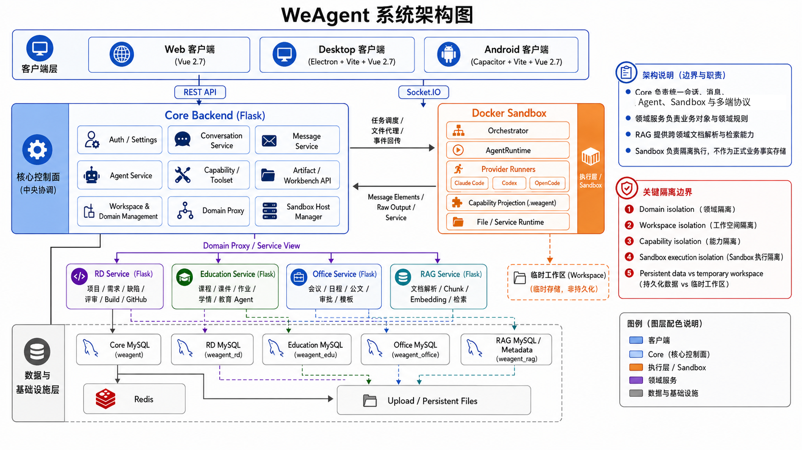

**图 3-1　WeAgent 总体系统架构**

总体链路可以概括为：

```text
用户
→ Web / Desktop / Android
→ Core Flask API 与 Socket.IO
→ Conversation / Workspace / Agent / Capability
→ Docker Sandbox 或 Domain Proxy
→ Provider Runner / 领域服务 / RAG
→ Core 与领域持久化
→ 消息元素、业务页面和工作台展示
```

系统各层职责如下：

| 层级 | 主要职责 | 关键实现 |
|---|---|---|
| 客户端层 | 用户交互、领域业务页面、会话、消息和产物展示 | `frontend/`、`clients/desktop/`、`clients/android/` |
| Core 控制面 | 认证、Workspace、会话、消息、Agent、Capability、Domain Proxy、Socket.IO 和 Sandbox 代理 | `backend/app/` |
| 领域服务层 | 承载 RD、Education 和 Office 的正式业务对象与规则 | `backend/services/rd/`、`edu/`、`office/` |
| RAG 层 | 文档、Chunk、Embedding、向量检索和访问范围 | `backend/services/rag/` |
| Sandbox 执行面 | 隔离 Agent、Provider CLI、工具、文件和预览服务 | `backend/app/sandbox/` |
| 数据层 | Core、领域、RAG 和运行文件的分层持久化 | MySQL、SQLite、Redis、Docker volume、上传目录 |

### 3.2 多端客户端边界

三个客户端共享 Core API，但工程形态和功能覆盖范围不同。

| 客户端 | 工程形态 | 后端连接 | 当前架构定位 |
|---|---|---|---|
| Web | Vue CLI + Vue 2.7 | 部署或开发环境 Core 地址 | 完整工作台和三个领域的主要业务入口 |
| Desktop | Electron + Vite + Vue 2.7 | 用户配置的 `serverUrl` | 通用会话、消息和产物的桌面客户端 |
| Android | Capacitor + Vite + Vue 2.7 | 局域网或公网 Core 地址 | 移动端核心流程，不作为完整领域工作台基准 |

客户端不直接访问 Docker Engine、Provider CLI 或领域数据库。通用业务通过 Core API，领域业务通常通过 Core Domain Proxy，实时消息通过 Socket.IO。

### 3.3 Core 控制面

Core 是系统的通用状态和执行控制中心，其职责包括：

- 用户认证与 JWT；
- Workspace 创建、成员关系和领域归属；
- Agent、Agent 分类和 Capability 的领域分类；
- 会话、参与者、消息和 AgentRun；
- Domain Proxy；
- Sandbox session 生命周期；
- Socket.IO 实时推送；
- 文件、服务和产物代理；
- 灰度配置和领域 UI 开关。

Core 的应用工厂在 `backend/app/__init__.py` 中初始化 SQLAlchemy、Migrate、JWT、CORS 和 Socket.IO，并注册各类 Blueprint。

Core 是控制面，不等同于执行面。它负责建立状态、授权和调度，真正的 Provider CLI、工具进程和任务文件位于 Sandbox 中。

### 3.4 Workspace 与领域隔离

Workspace 是三个领域接入通用平台的第一层边界。`Workspace.domain` 只允许：

- `rd`
- `edu`
- `office`

Workspace 保存所有者、成员、名称、状态和领域；Education 还可以使用 `sub_role` 表示教师或学生工作空间类型。

与领域相关的 Core 字段包括：

| 对象 | 领域字段或关联 | 作用 |
|---|---|---|
| `Workspace` | `domain`、`sub_role` | 定义工作空间所属领域 |
| `Conversation` | `workspace_id`、`kb_domain`、`services`、`sandbox_agent_service_views` | 保存会话领域和服务上下文 |
| `Agent` | `domain` | 按领域组织可选 Agent |
| `Capability` | `domain` | 按领域组织工具能力 |
| `AgentCategory` / `ToolsetCategory` | `domain` | 按领域组织分类 |
| `GrayscaleConfig` | `domain`、`domains` | 控制各领域功能和 UI 可见性 |

领域隔离不是只依赖一个前端选择框，而是由 Workspace、模型字段、会话上下文、服务代理、Sandbox 环境和 RAG Scope 共同实施。

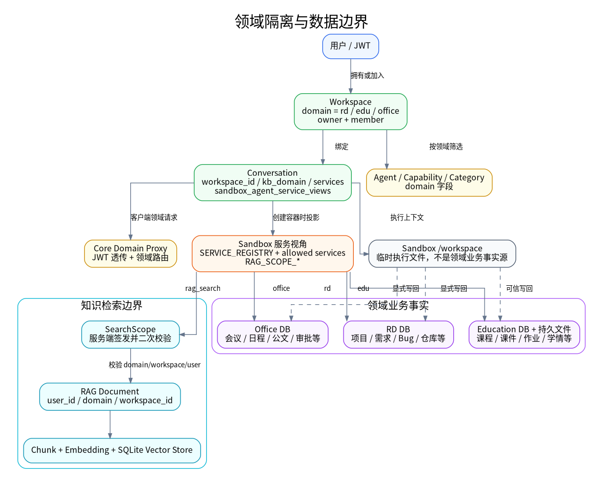

**图 3-2　领域隔离与数据边界**

### 3.5 Domain Proxy 与领域服务

Core 注册 `domain_proxy_bp`，向客户端提供统一网关：

```text
/api/domain/<domain>/health
/api/domain/<domain>/<path>
```

默认映射为：

```text
rd      → 127.0.0.1:5101/api/rd/*
edu     → 127.0.0.1:5102/api/edu/*
office  → 127.0.0.1:5103/api/office/*
rag     → 127.0.0.1:5104/api/rag/*
```

除健康检查外，通用领域代理要求 JWT，并透传请求方法、查询参数、请求体和主要 Header。multipart 请求使用独立转发逻辑，支持领域文件上传。

Domain Proxy 的作用是：

- 让 Web 等客户端使用统一 Core 地址；
- 避免客户端硬编码不同服务地址；
- 复用 Core JWT；
- 在领域服务不可达时统一返回网关错误；
- 为领域灰度和后续服务治理提供入口。

当前代理端口映射定义在 `backend/app/controllers/domain_proxy_controller.py`。它是开发环境中的静态注册表，不是完整的动态服务发现中心。

### 3.6 独立领域服务边界

三个领域拥有独立应用和数据库，正式业务对象不存放在 Core 会话表或 Sandbox 工作区中。

#### RD

RD 服务注册项目、迭代、需求、Bug、评论、分支、成员、活动、仓库、Review 和 Build 等 Blueprint，业务模型位于 `backend/services/rd/models/`。

#### Education

Education 服务注册课程基础、工作流、内容、资产、知识、学习、可信工具和会话绑定等 Blueprint。其专用上下文和授权逻辑比另外两个领域更深，将在领域章节详细说明。

#### Office

Office 服务注册会议、日程、公文、模板、审批和组织等 Blueprint，并使用独立业务数据库，同时读取 Core Workspace 所有权信息实施访问控制。

领域服务均可暴露服务规范端点，让 Sandbox Agent 了解服务能力和常用 API。但服务规范是调用说明，真正权限仍由 JWT、Workspace、领域服务和工具层校验。

### 3.7 Docker Sandbox 执行边界

Core 为正式 Agent 会话创建或恢复 Sandbox session。容器内主要区域包括：

| 路径 | 内容 | 边界 |
|---|---|---|
| `/workspace/agents/<workspace_name>` | 单个 Agent 的私有文件 | Agent 执行产物 |
| `/workspace/shared` | 多 Agent 共享文件 | 团队协作文件 |
| `/workspace/.weagent` | Capability、Tool、MCP 和 Plugin 投影 | 当前会话能力视图 |
| `/workspace/.session` | 会话事件、服务和运行状态 | 容器运行状态 |

Sandbox 可以访问经授权的领域服务和 RAG，但其文件系统是执行空间，不是领域业务数据库。需要成为正式业务对象的内容，必须通过领域 API 或可信工具写回相应数据库。

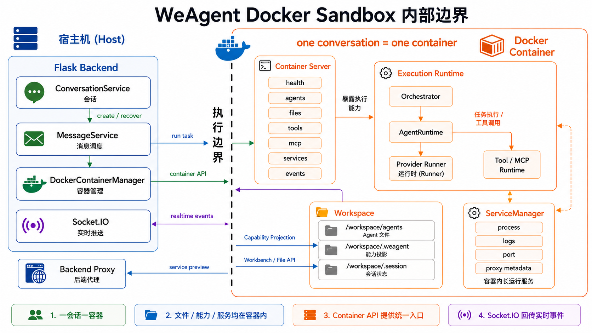

**图 3-3　Docker Sandbox 内部边界（沿用旧版飞书图，按当前 main 分支概念复核）**

### 3.8 Agent 服务发现与调用

Core 创建 Sandbox 时会注入服务相关环境，包括：

- `SERVICE_REGISTRY`
- `CONVERSATION_SERVICES`
- `RAG_SCOPE_USER_ID`
- `RAG_SCOPE_DOMAIN`
- `RAG_SCOPE_WORKSPACE_ID`
- `RAG_SCOPE_EDUCATION_ROLE`

容器工具注册表提供：

- `list_services`：列出当前可见服务；
- `call_service_api`：调用指定领域服务 API；
- `rag_search`：兼容性 RAG 检索工具，内部委托通用服务调用。

服务调用链路为：

```text
Conversation / Agent 配置
→ Core 计算并注入服务上下文
→ Sandbox SERVICE_REGISTRY 与允许服务
→ Agent 使用 list_services
→ 读取 /api/<service>/spec
→ call_service_api 或 rag_search
→ 领域服务或 RAG 校验请求
```

Education 会对单个 Agent 的服务视角实施更严格的专用计算；其他领域主要使用会话服务列表和通用服务注册表。后续章节将分别说明。

### 3.9 RAG 架构与访问范围

RAG 服务将知识数据拆为三个层次：

1. `Document`：文档元数据，保存 `user_id`、`domain`、`workspace_id`、来源和状态；
2. `Chunk`：文本分块、页码、Token 数和向量 ID；
3. `SimpleVectorStore`：保存 Embedding、Chunk 文本和向量元数据，并执行余弦相似度检索。

检索范围由 `SearchScope` 确定：

- 外部 JWT 请求以当前用户为边界；
- Sandbox 内部请求必须携带服务端注入的用户和领域；
- 指定 Workspace 时，文档必须属于该 Workspace；
- Education 学生检索还要求资源已发布到课程范围。

RAG 检索不会仅依赖向量库的 metadata filter。向量召回后仍会根据 MySQL 中的文档记录执行持久化权限校验，从而避免仅依靠客户端参数扩大检索范围。

### 3.10 数据持久化边界

WeAgent 的数据不能被简单理解为“全部存 MySQL”或“全部在 Sandbox”。不同数据有不同权威来源。

| 数据类型 | 权威位置 | Sandbox 删除后的预期 |
|---|---|---|
| 用户、Workspace、Agent、Capability、会话、消息 | Core MySQL `weagent` | 保留 |
| RD 业务对象 | `weagent_rd` | 保留 |
| Education 业务对象 | `weagent_edu` 及配置的持久上传目录 | 保留 |
| Office 业务对象 | `weagent_office` | 保留 |
| RAG 文档与 Chunk 元数据 | `weagent_rag` | 保留 |
| RAG Embedding | `simple_vector_store.db` | 取决于向量文件是否持久化 |
| 消息中的结构化结果 | Core `Message.elements` 等字段 | 保留 |
| Agent 临时文件和执行日志 | Sandbox `/workspace` | 取决于容器 volume、snapshot 和恢复策略 |
| 已写回领域的业务产物 | 对应领域数据库 | 保留，不依赖旧容器 |

部署时需要特别确保：领域上传目录、RAG 向量 SQLite 文件和需要恢复的 Sandbox volume 不能仅存在于易失容器层。

### 3.11 通信方式与信任边界

| 通信链路 | 协议 | 主要约束 |
|---|---|---|
| 客户端 → Core | REST / Socket.IO | JWT、会话归属和 Core API |
| 客户端 → 领域服务 | 通常经 Core Domain Proxy | JWT 透传、领域路由和服务可用性 |
| Core → Sandbox | 宿主代理 / Container API | session 归属、容器健康和文件路径 |
| Sandbox → 领域服务 | HTTP 工具调用 | SERVICE_REGISTRY、允许服务、JWT 或内部上下文 |
| Sandbox / 领域服务 → RAG | HTTP | RAG Scope、领域、Workspace 和角色 |
| Core / 领域服务 → MySQL | SQLAlchemy / PyMySQL | 数据库连接和模型边界 |
| 各服务 → Redis | Redis Client | 辅助状态，不替代业务数据库 |

### 3.12 当前实现差异与后续章节边界

当前代码中，三领域共享基础架构，但以下差异需要在后续文档中保留：

- Education 有专用 Conversation Binding、角色解析、工具授权、业务卡片和可信写回；
- RD 有较完整的研发对象、GitHub 接入、Review 和 Build 模块；
- Office 有独立组织、会议、公文、日程和审批模型，并读取 Core Workspace 所有权；
- RAG 是共享服务，但 Education 的课程与成员范围校验更严格；
- Web 已包含三个领域的业务页面，Desktop 和 Android 不能直接按 Web 的覆盖范围描述。

第 4～6 章将进一步展开模块、实现链路和数据流；第 10 章再集中说明三个领域的业务模型和差异。

## 4. 核心模块

WeAgent 的模块划分不是简单的前后端目录划分，而是围绕三类责任展开：**交互与展示、控制与持久化、隔离执行与领域业务**。理解模块时，需要先区分控制面和执行面：Core 后端负责创建状态、校验权限和组织调用；Docker Sandbox 才负责真实的 Agent、命令、文件和服务执行；RD、Education、Office 与 RAG 则保存并提供领域业务事实。

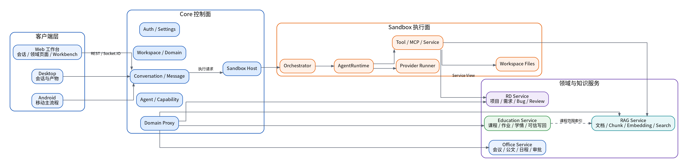

**图 4-1　WeAgent 核心模块地图**

### 4.1 客户端模块

客户端负责把通用会话能力、领域业务页面和结构化产物组织为用户可操作的界面。客户端不会直接连接 Docker，也不会直接读取领域数据库；文件、服务、消息和业务数据均通过 Core 或 Domain Proxy 访问。

| 模块 | 主要职责 | 关键实现 |
|---|---|---|
| Web 主工作台 | 会话列表、消息交互、Agent 配置、工作区、产物抽屉和实时事件 | `frontend/src/views/Dashboard.vue`、`frontend/src/components/ChatWindow/` |
| 消息渲染 | Markdown、代码、进度、文件、图片、表格、diff、workflow、service 及领域卡片 | `frontend/src/components/MessageBubble/` |
| Artifact Workbench | 按产物类型选择代码、HTML、表格、图片或差异视图，并通过文件 API 写回 Sandbox | `frontend/src/components/ArtifactWorkbench/` |
| Workspace 与领域入口 | 选择 RD、Education、Office 工作空间，并将会话绑定到领域上下文 | `frontend/src/views/`、`frontend/src/router/index.js` |
| RD 页面 | 项目、需求、Bug、迭代、仓库、Build、Review 和甘特图 | `frontend/src/views/rd/` |
| Education 页面 | 课程、课时、课件、知识、作业、提交、测评、弱点和学情 | `frontend/src/views/education/`、`frontend/src/components/education/` |
| Office 页面 | 组织、会议、行动项、日程、公文、通知和审批 | `frontend/src/views/Office*.vue` |
| Desktop | 使用 Electron 外壳连接外部 Core 服务，复用会话、Socket.IO 和主要产物能力 | `clients/desktop/` |
| Android | 使用 Capacitor 和 WebView 承载登录、会话、Agent 和设置等移动端主流程 | `clients/android/` |

Web 是三个领域和完整 Workbench 的主要基准。Desktop 与 Android 使用相同的后端协议，但不能据此推断三端页面已经完全同构；技术文档只描述其代码入口和协议复用，不把 Web 能力自动外推到其他端。

### 4.2 Core 后端业务模块

Core Flask 后端是系统控制面。它负责把用户操作转换为可持久化、可授权和可调度的状态，再把需要真实执行的任务交给 Sandbox。

| 模块 | 作用 | 关键入口 |
|---|---|---|
| Auth | 注册、登录、用户资料、Token 刷新和用户目录 | `auth_controller.py`、`auth_service.py` |
| Settings | 用户模型、API Key、Base URL、自定义模型和容器运行参数 | `settings_controller.py`、`settings_service.py` |
| Workspace | 创建、查询、归档工作空间和成员关系；保存 `rd/edu/office` 领域 | `workspace_controller.py`、`workspace_service.py` |
| Conversation | 会话、参与者、收藏、附件、Sandbox 绑定、运行预检和生命周期 | `conversation_controller.py`、`conversation_service.py` |
| Message | 用户消息、Agent 调度、会话级配置、工作流输入和消息恢复 | `message_controller.py`、`message_service.py` |
| Agent | 全局 Agent 定义、分类、系统提示词、Skill 和 Provider Adapter | `agent_controller.py`、`agent_service.py` |
| Capability | Skill、Tool、MCP、Plugin 的导入、版本、审查、绑定和调用记录 | `capability_controller.py`、`capability_service.py` |
| Artifact | 保存部分可复用的 code、webpage、document、ppt 和 diff 产物 | `artifact_controller.py`、`artifact_service.py` |
| Domain Proxy | 将 `/api/domain/<domain>/*` 转发到 RD、Education、Office 或 RAG | `domain_proxy_controller.py` |
| Grayscale | 维护领域级功能开关和灰度配置 | `grayscale_controller.py`、`grayscale_service.py` |
| Sandbox Event Bridge | 把容器事件转换为 Message、AgentRun 和 Socket.IO 更新 | `sandbox_event_bridge.py` |

Core 不应承担领域业务对象的最终存储。例如，RD 的需求、Education 的作业、Office 的公文分别属于独立领域数据库；Core 只保存通用用户、工作空间、会话、消息、Agent、Capability 和 Sandbox 状态。

### 4.3 Workspace 与领域管理模块

`Workspace` 是通用平台进入领域业务的第一层边界。模型中的核心字段包括：

- `user_id`：工作空间创建者；
- `domain`：`rd`、`edu` 或 `office`；
- `sub_role`：Education 中可用于区分 `teacher/student` 的附加角色信息；
- `name`、`description`、`status`：工作空间基础信息；
- `WorkspaceMember`：工作空间和用户之间的成员关系。

会话通过 `Conversation.workspace_id` 关联工作空间，并通过 `kb_domain`、`services`、`project_id`、`sandbox_agent_service_views` 等字段保存执行所需的领域快照。这里需要区分：Workspace 决定用户处于哪个业务空间；领域服务中的项目、课程和组织对象仍由各自服务负责。

### 4.4 会话、消息与执行状态模块

一次 Agent 任务并不只对应一条消息。Core 使用多个模型共同表达一次执行：

| 对象 | 主要职责 | 关键状态 |
|---|---|---|
| `Conversation` | 会话元数据、工作空间、领域、服务视角和 Sandbox 生命周期 | `sandbox_status`、`sandbox_generation`、快照字段 |
| `ConversationParticipant` | 保存用户和 Agent 的参与关系及名称、头像快照 | `participant_type`、`participant_id` |
| `Message` | 用户可见输入、回复、结构化元素和底层原始输出 | `status`、`elements`、`raw_output`、`round_id`、`run_id` |
| `AgentRun` | 某个 Agent 在一轮任务中的执行记录 | `pending/running/done/error/stopped`、`last_seq`、`error` |
| `Artifact` | 部分可复用产物记录 | `artifact_type`、`content`、`preview_url`、`version` |

`Message.status` 和 `AgentRun.status` 需要同步，但二者不是同一个概念：前者服务用户界面，后者记录执行实例。`AgentRun.last_seq` 用于处理增量事件顺序，避免同一事件重复写入或乱序覆盖。

### 4.5 Sandbox Host 模块

宿主侧 Sandbox 模块位于 `backend/app/sandbox/host/`，负责 Docker 生命周期和请求代理，不直接实现 Agent 推理。

核心职责包括：

- 检查和构建 `weagent-sandbox:latest` 镜像；
- 为会话创建、恢复、停止和销毁容器；
- 维护 session、container ID、宿主端口和状态；
- 将用户模型配置、Service Registry、Agent Service View 和运行 Token 注入容器；
- 代理容器的 Agent、文件、工具、MCP、服务和事件 API；
- 执行工作区快照、恢复和会话间文件迁移；
- 校验当前用户是否有权访问会话对应的 Sandbox。

宿主 API 统一注册在 `/api/sandbox/*`。客户端访问的文件、服务和日志接口均先经过 Core 权限检查，再由 Host Manager 转发到对应容器。

### 4.6 Container Runtime 模块

容器执行面位于 `backend/app/sandbox/container/`，主要由以下组件构成：

| 组件 | 职责 | 关键文件 |
|---|---|---|
| Container Server | 暴露容器内部的 Agent、文件、工具、MCP、服务和上报 API | `server.py` |
| Orchestrator | 创建 AgentRuntime、管理任务链、准备工具说明和收集结果 | `orchestrator.py` |
| AgentRuntime | 准备 Agent 私有工作区、运行提示词和 Provider Runner | `agent.py` |
| ProviderRunnerFactory | 根据 `adapter_name` 创建具体 Runner | `providers/factory.py` |
| ToolRegistry | 注册内置工具、Capability 工具和服务调用工具 | `tools/__init__.py` |
| MCP Runtime | 启动 manifest 中声明的 MCP Server 并调用工具 | `mcp_runtime.py` |
| ServiceManager | 管理容器内长运行预览服务、端口、日志和代理路径 | `service_manager.py` |
| Capability Projection | 读取 `/workspace/.weagent` 下的 Session-local 能力视图 | `capabilities.py` |

容器内的 `/workspace` 是执行空间，不等同于正式业务数据库。Agent 生成的临时文件只有在写回消息、领域服务或持久化资产后，才成为可恢复的正式结果。

### 4.7 Provider Adapter 模块

Provider Adapter 将 Claude Code、Codex 和 OpenCode 的 CLI 差异封装在统一 Runner 接口之后。上层只需要指定 `adapter_name`，不需要感知各 CLI 的命令格式和流式输出协议。

| Provider | Runner | 主要处理 |
|---|---|---|
| Claude Code | `ClaudeCodeRunner` | 命令构造、模型和认证环境、会话恢复、输出读取 |
| Codex | `CodexRunner` | API Key/认证文件、配置、Relay、JSON 输出和停止逻辑 |
| OpenCode | `OpenCodeRunner` | Base URL、模型、认证和输出格式 |
| 通用层 | `ProviderRunner` | 超时、环境注入、进程管理、stdout/stderr 和错误统一 |

Provider Runner 输出不会直接写入前端。输出先进入 AgentRuntime/Orchestrator，再通过结构化事件和 `SandboxEventBridge` 转换为消息状态与元素。

### 4.8 Capability、Toolset 与 MCP 模块

Capability 将四类扩展能力统一建模：Skill、Tool、MCP 和 Plugin。平台保存不可变版本、资产、权限、Agent 绑定和调用审计；会话执行时只向当前 Agent 投影已授权版本。

主要模型包括：

- `Capability`：名称、类型、领域、来源和最新版本；
- `CapabilityVersion`：版本内容、manifest、权限和校验和；
- `CapabilityVersionAsset`：版本附属文件；
- `AgentCapabilityBinding`：Agent、版本策略和授权快照；
- `CapabilityCallRecord`：工具名、输入输出摘要、权限、状态和错误；
- `ToolProviderConfig`：某个工具调用外部 Provider 时使用的配置。

这里需要严格区分：`Agent.adapter_name` 选择 Agent 的底层 AI Coding 引擎；`ToolProviderConfig.provider_type` 配置某个工具自身使用的外部服务。二者处于不同层级。

### 4.9 Domain Proxy 与领域服务模块

Core 的 Domain Proxy 使用固定服务映射：RD `5101`、Education `5102`、Office `5103`、RAG `5104`。客户端请求 `/api/domain/<domain>/<path>` 时，Core 转发方法、查询参数、请求体和认证头；上传请求会单独处理 multipart 数据。

| 领域服务 | 主要模块 | 正式业务对象 |
|---|---|---|
| RD | project、iteration、requirement、bug、repo、review、build、member、comment、activity | 项目、迭代、需求、缺陷、仓库、分支、提交、Review 和 Build |
| Education | course、content、asset、knowledge、learning、workflow、tool、conversation | 课程、课时、教案、课件、作业、提交、反馈、题库、试卷、知识和学情 |
| Office | organization、meeting、schedule、document、template、approval | 组织、会议、行动项、日程、公文、模板、签收和审批 |
| RAG | document、chunk、embedding、vector、search、access scope | 文档元数据、Chunk、向量、检索范围和来源化结果 |

领域服务均暴露 `/api/<domain>/spec`，供 Agent 或 Core 获取服务能力摘要。服务自描述不替代权限控制；实际调用仍需通过 JWT、Internal API Key、Service View 或领域侧成员关系校验。

### 4.10 RAG 模块

RAG 服务是独立 Flask 应用，负责文档导入、解析、Chunk、Embedding、向量数据和检索。当前代码中的实际向量实现为 `SimpleVectorStore`，使用 SQLite 保存向量数据；`.env.example` 中的 ChromaDB/Milvus 配置仍标记为后续接入，不应描述为当前运行组件。

核心模块：

| 模块 | 作用 |
|---|---|
| `Document` | 保存文件名、来源、领域、工作空间、所有者、可见性和处理状态 |
| `Chunk` | 保存文本片段、来源位置和向量关联 |
| Parser/Scraper | 处理上传文件、URL 下载和安全网页抓取 |
| `EmbeddingService` | 生成向量；支持本地确定性向量及配置的外部 Provider |
| `SimpleVectorStore` | 保存和查询向量 |
| `SearchScope` | 服务端解析用户、领域、工作空间、课程角色和文档白名单 |
| Search Controller | 提供语义检索和混合检索 |

### 4.11 数据模块和正式事实边界

WeAgent 同时存在多种数据载体，维护时不能把它们混为一个“文件库”或“产物表”。

| 数据类型 | 权威位置 | 典型内容 |
|---|---|---|
| 通用平台状态 | Core MySQL | 用户、Workspace、Agent、Capability、会话、消息、AgentRun、Artifact |
| RD 业务事实 | `weagent_rd` | 项目、需求、Bug、迭代、仓库、Review、Build |
| Education 业务事实 | `weagent_edu` | 课程、课时、课件、作业、提交、反馈、知识和学情 |
| Office 业务事实 | `weagent_office` | 组织、会议、日程、公文、模板、签收、审批 |
| RAG 元数据 | `weagent_rag` | Document、Chunk、范围与处理状态 |
| 向量数据 | SQLite `SimpleVectorStore` | Chunk 对应的向量和检索数据 |
| 持久文件 | 上传目录或后续对象存储 | 原始 PDF、DOCX、图片和领域资产 |
| 临时执行状态 | Sandbox `/workspace` | Agent 私有文件、服务日志、工具和会话运行文件 |

---

## 5. 核心技术实现

本章说明上述模块如何协作。WeAgent 的主链路采用“**同步创建状态 + 异步容器执行 + 结构化事件持久化 + 刷新可恢复**”的设计。

### 5.1 前后端通信与实时推送

系统同时使用 REST API 和 Socket.IO：

- REST 负责认证、资源创建、配置保存、消息提交、文件读写和服务控制；
- Socket.IO 负责会话 room、消息创建、状态变化、元素增量和工作流计划；
- 连接中断或页面刷新后，客户端重新读取消息列表，并以数据库中的 `Message.elements` 与 `Message.raw_output` 为恢复依据。

关键事件包括：

| 事件 | 含义 |
|---|---|
| `conversation_message_created` | 创建用户消息、Agent 占位消息或系统结果消息 |
| `conversation_message_status` | 更新消息执行状态和错误 |
| `conversation_message_element_stream` | 增量追加 progress、file、table、service、workflow 等元素 |
| `conversation_run_plan` | 推送多 Agent 的服务端工作流计划 |

实时推送只负责降低等待感，不能成为唯一数据源。所有需要刷新恢复的状态必须写入 Core 数据库或 Sandbox 持久文件。

### 5.2 会话创建、领域上下文与 Sandbox 绑定

创建会话时，Core 不只新增 `Conversation`。它还需要：

1. 校验会话所有者、参与者和 Workspace；
2. 解析 `kb_domain`、`services`、`project_id` 或 Education 课程绑定；
3. 合并 Agent 默认配置和会话级配置；
4. 计算每个 Agent 的 Adapter 与 Service View；
5. 创建或恢复 Sandbox session；
6. 注入用户模型配置、Service Registry、认证信息和 RAG 文档范围；
7. 将 Capability 投影到 `/workspace/.weagent`；
8. 更新 `Conversation.sandbox_*` 字段。

RD 可以通过 `project_id` 构造项目上下文；Education 额外使用 `EducationConversationBinding` 和实时 `CourseMembership` 建立可信课程上下文；Office 主要通过 Workspace、服务视角和领域 API 接入。

### 5.3 Agent 执行与事件闭环

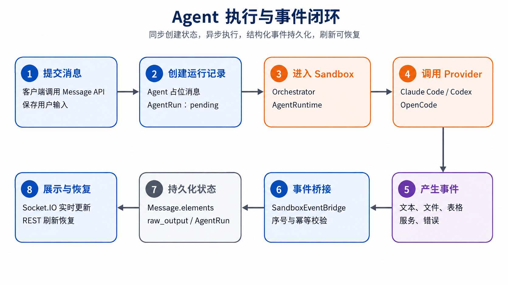

**图 5-1　Agent 执行、事件持久化与刷新恢复闭环**

消息提交后，Core 先保存用户消息和 Agent 占位消息，并为每个目标 Agent 创建 `AgentRun`。Sandbox 中的 AgentRuntime 根据 `adapter_name` 调用 Provider Runner。运行过程中的文本、文件变化、表格、图片、服务和错误通过容器事件或 `weagent-report` 上报。

`SandboxEventBridge` 负责：

- 校验 session、run、agent 和事件序号；
- 将容器事件归一化为 Message Element；
- 更新 `Message.status`、`raw_output` 和 `AgentRun.status`；
- 使用 `last_seq` 避免重复或乱序事件；
- 通过 Socket.IO 推送给会话内客户端。

这一设计把 Provider CLI 的具体流式格式隔离在容器内部，前端只消费稳定的消息语义。

### 5.4 单 Agent 与多 Agent 调度

单 Agent 会话直接将用户任务交给目标 Agent。多 Agent 会话由 Moderator 读取团队成员、能力摘要、Service View 和用户目标，生成服务端工作流计划，再委派给 worker。

多 Agent 调度需要满足三个约束：

- 被会话级配置标记为 `enabled=false` 的 Agent 不参与分配；
- worker 只能使用自己的 Capability 和 Service View，不能继承团队并集权限；
- Moderator 的计划和 worker 的执行记录必须通过 `round_id/run_id` 与当前轮次关联。

工作流计划以 `workflow` 类型消息元素展示，也可以由用户编辑后作为下一轮消息的 `workflow` payload。它是调度上下文，不等同于普通 JSON 文件。

### 5.5 Provider Runner 的统一执行接口

Provider Runner 公共层处理：

- 工作目录和环境变量；
- CLI 命令构造；
- 进程启动、停止和超时；
- stdout/stderr 读取；
- JSON 流或文本流解析；
- 非零退出码、认证失败和 CLI 不存在等错误；
- 必要的 resume/session 参数。

新增 Provider 时，应在 `backend/app/sandbox/container/providers/` 内实现新的 Runner，并通过 Factory 注册，而不是修改 Conversation、Message 或前端组件。

### 5.6 文件系统、预览服务与代理

Sandbox 文件 API 支持：文件树、Raw 读取、下载、ZIP 导出、写回和会话间迁移。前端打开产物时需先判断：

- 元素是否已经包含可直接展示的内联内容；
- 是否需要根据 `path` 从当前 Sandbox 读取文件；
- 当前会话和用户是否仍有权访问该 session。

HTML 预览需要处理相对 CSS、JavaScript 和图片路径。后端会通过 base 注入和 workspace 资源改写，使资源继续经过受控代理，而不是让客户端直接访问容器路径。

ServiceManager 用于启动容器内长运行服务。服务记录包括命令、工作目录、端口、日志和状态；宿主后端通过受控 Proxy URL 暴露预览，并校验 session、service 和访问 Token。

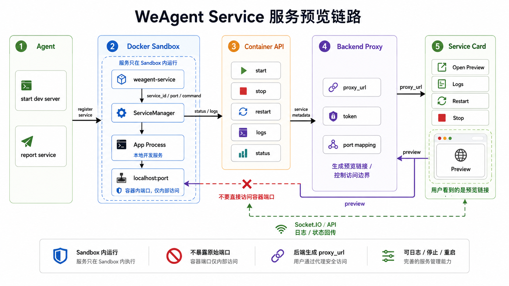

**图 5-5　Service 服务预览链路（沿用旧版飞书图，按当前 main 分支概念复核）**

### 5.7 Message Element 与 Artifact Workbench

Message Element 是会话展示的核心结构，常见类型包括：

- `progress`、`text`、`result`、`summary`；
- `code`、`file`、`image`、`table`；
- `diff`、`workflow`、`service`；
- RD、Education、Office 的领域卡片。

`Artifact` 表不是所有消息产物的统一存储。运行时元素主要位于 `Message.elements`，底层输出位于 `raw_output`，真实文件位于 Sandbox 或持久文件目录；只有部分需要复用或版本化的产物进入 `Artifact`。

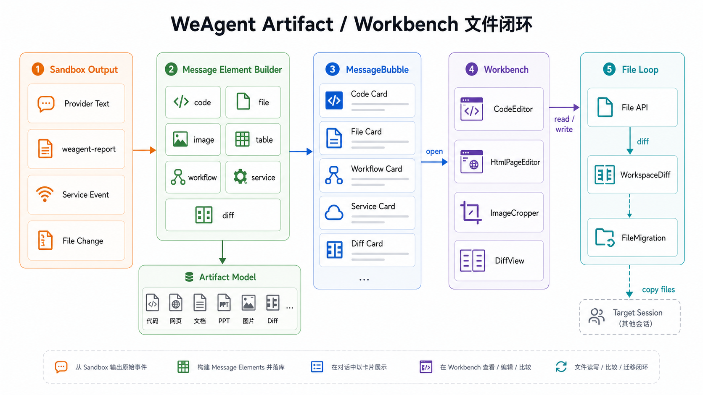

**图 5-6　Artifact / Workbench 文件闭环（沿用旧版飞书图，按当前 main 分支概念复核）**

### 5.8 会话级 Agent 配置合并

客户端可在发送消息时提交 `agent_configs`，覆盖当前会话中的：

- 角色名称；
- `system_prompt`；
- `skill`；
- `enabled`；
- `adapter_name`；
- 领域运行所需的附加上下文。

合并结果只进入当前执行上下文，不回写全局 Agent 表。请求 Schema、消息服务的规范化逻辑和容器 Agent 配置必须同步支持相同字段，否则会出现“前端提交成功但运行时未生效”的隐性错误。

### 5.9 Capability Projection 与 MCP Runtime

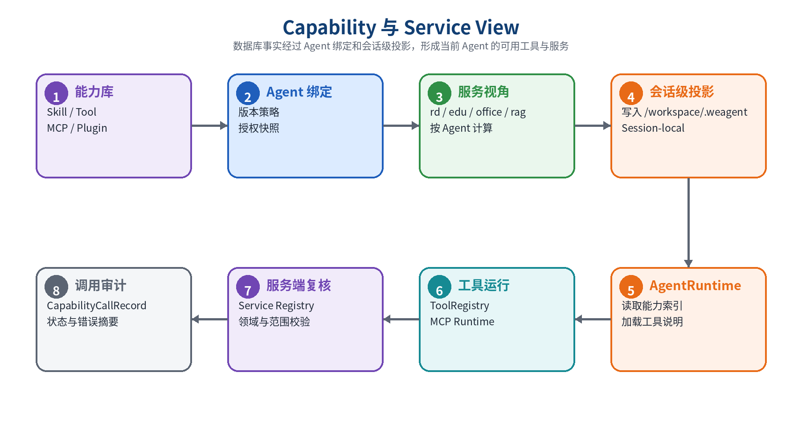

**图 5-2　Capability、Service View 与会话级投影**

Capability 的数据库记录是事实源，Sandbox 中的 `.weagent` 只是当前 session 的运行视图。投影过程为：

1. 根据 Agent 绑定读取有效 Capability 和版本；
2. 解析权限、工具名、MCP manifest 和 Tool Provider 配置；
3. 将 Skill、Tool、MCP、Plugin 索引写入 `/workspace/.weagent`；
4. AgentRuntime 读取会话局部索引；
5. ToolRegistry 或 MCP Runtime 执行调用；
6. 将调用摘要和错误同步到 `CapabilityCallRecord`。

投影的价值是让不同 Agent 在同一会话中仍拥有不同能力边界，也便于会话恢复时重新生成运行视图。

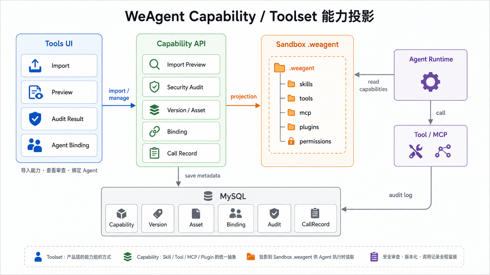

**图 5-7　Capability / Toolset 能力投影细节（沿用旧版飞书图，按当前 main 分支概念复核）**

### 5.10 Agent Service View 与领域调用

会话可以保存服务并集，但单个 Agent 的权限由 `sandbox_agent_service_views` 决定。容器内的 `list_services` 只返回当前 Agent 可见服务，`call_service_api` 也会基于 Service Registry 和 Agent ID 再次校验。

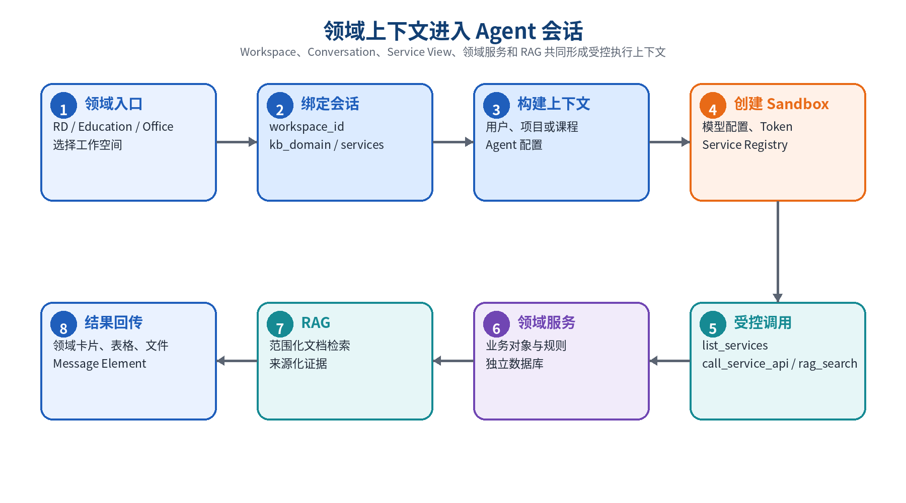

**图 5-3　Workspace、会话、Sandbox 与领域服务的数据流**

通用领域调用通常采用：

```text
Agent
→ list_services
→ 获取服务 Spec
→ call_service_api
→ 领域服务 JWT/Workspace 校验
→ 返回业务对象
→ 转换为领域卡片或表格
```

Education 写操作是例外：代码明确阻止通过通用 `call_service_api` 直接执行 Education 写入，要求使用 `education_action`。Tool Gateway 会校验短期 Grant、用户、课程、角色、Agent、动作和幂等键，再写入正式业务对象。

### 5.11 RAG 文档处理与检索实现

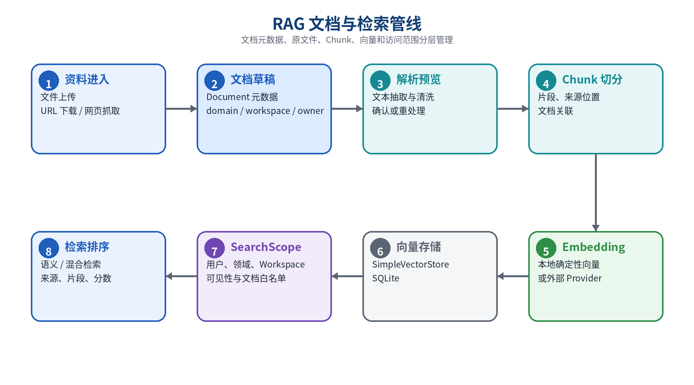

**图 5-4　RAG 文档入库、向量化与范围化检索管线**

RAG 文档采用草稿—确认—索引的生命周期：

1. 上传文件、下载 URL 或安全抓取网页；
2. 保存 Document 元数据和原文件；
3. 解析文本并生成预览；
4. 用户或领域服务确认后切分 Chunk；
5. EmbeddingService 生成向量；
6. SimpleVectorStore 将向量写入 SQLite；
7. 搜索时根据 SearchScope 过滤 Document 和 Chunk；
8. 返回文档、片段、相似度、来源和定位信息。

混合搜索在语义候选基础上加入关键词匹配。SearchScope 不是客户端自由传入的过滤器，而是服务端根据认证主体、领域、Workspace、文档白名单和 Education 课程角色解析出的访问范围。

### 5.12 安全与信任边界

系统的主要信任边界包括：

| 边界 | 控制方式 |
|---|---|
| 用户与 Workspace | JWT、所有者和成员关系校验 |
| Conversation 与 Sandbox | 会话所有权、session 绑定和 generation 校验 |
| Agent 与 Capability | AgentCapabilityBinding、权限快照和 session-local 投影 |
| Agent 与领域服务 | Service View、Service Registry、JWT/Internal API Key 和领域成员关系 |
| RAG 检索 | SearchScope、domain、workspace、owner、visibility 和 document IDs |
| Provider 凭据 | Core 保存配置，按需注入容器，不写入消息和产物 |
| 文件与服务 | 后端代理、路径规范化、service token 和 session 校验 |
| Education 写回 | RunGrant、Tool Gateway、指定 Agent、动作白名单和幂等键 |

---

## 6. 关键数据流

本章从“谁产生数据、经过哪些模块、最终存在哪里、用户如何看到”四个角度整理关键链路。图和步骤用于说明当前代码关系，不替代接口级协议。

### 6.1 Workspace 与领域会话数据流

```text
用户选择 RD / Education / Office
→ Core 创建或读取 Workspace
→ 创建 Conversation 并写入 workspace_id、kb_domain、services
→ 根据领域准备项目、课程或组织上下文
→ 计算 Agent Service View
→ 创建或恢复 Sandbox
→ 将领域工具、RAG Scope 和 Capability 投影给 Agent
```

**最终状态：** Workspace 和 Conversation 位于 Core MySQL；领域业务对象位于对应数据库；Sandbox 保存运行快照和临时文件。

### 6.2 创建会话数据流

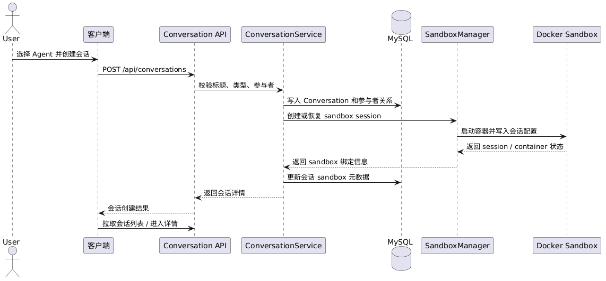

**图 6-1　创建会话与 Sandbox 绑定时序（沿用旧版飞书图，按当前 main 分支概念复核）**

1. 客户端提交会话标题、类型、参与者和 Workspace；
2. `ConversationService` 校验参与者和领域参数；
3. 写入 `Conversation` 与 `ConversationParticipant`；
4. 构建模型配置、Adapter、Service View 和 Capability Projection；
5. Host Manager 创建 Docker session；
6. 更新 `sandbox_session_id`、container、port、status 和 generation；
7. 客户端进入会话并加入 Socket.IO room。

创建 Conversation 成功不代表 Sandbox 一定健康，因此运行前仍可通过 `runtime-preflight` 检查依赖和上下文。

### 6.3 单 Agent 消息执行数据流

```text
POST /api/messages
→ 保存用户 Message
→ 创建 Agent 占位 Message
→ 创建 AgentRun
→ Host Manager 调用 Container API
→ AgentRuntime 选择 Provider Runner
→ Provider 输出与文件变化形成 Sandbox Event
→ SandboxEventBridge 更新 Message / AgentRun
→ Socket.IO 推送
→ 刷新时 GET /api/messages/conversation/<id> 恢复
```

### 6.4 多 Agent 协作数据流

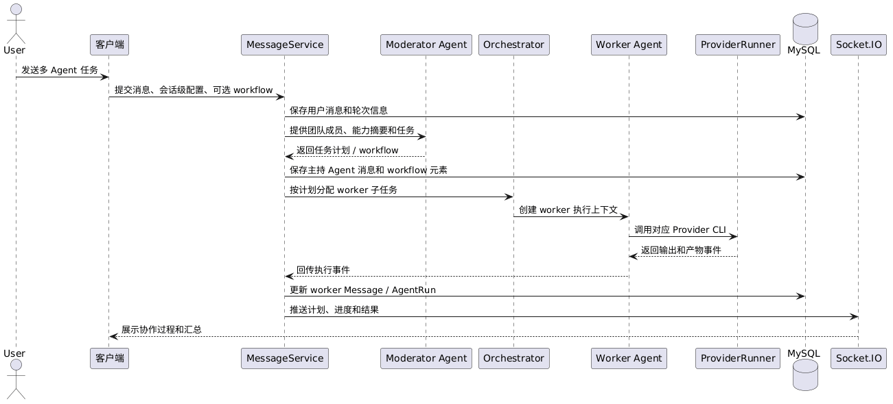

**图 6-2　多 Agent 计划、执行与回传时序（沿用旧版飞书图，按当前 main 分支概念复核）**

1. 用户提交团队任务；
2. Core 读取会话 Agent、禁用状态、Skill 和 Service View；
3. Moderator 生成任务计划；
4. 工作流以 `workflow` 元素保存和推送；
5. Orchestrator 为 worker 创建执行上下文；
6. 每个 worker 使用自己的 Provider、Capability 和 Service View；
7. worker 结果分别持久化；
8. Moderator 或服务端生成最终汇总。

### 6.5 Sandbox Event 回传数据流

事件可能来自 Provider Runner、AgentRuntime、`weagent-report`、ToolRegistry 或 ServiceManager。事件桥接层根据事件类型执行：

| 事件 | Core 处理 | 用户表现 |
|---|---|---|
| progress/text | 追加元素或更新当前阶段 | 显示进度和过程说明 |
| file/code/image/table | 保存结构化元素和路径 | 产物卡片或工作台 |
| workflow | 保存计划节点和连接 | 工作流预览与复用 |
| service | 保存服务 ID、状态和代理信息 | 服务预览、日志和控制 |
| raw/provider output | 更新 `raw_output` | 故障定位或降级展示 |
| error/stopped | 更新 Message 与 AgentRun | 显示明确失败或停止状态 |

### 6.6 产物生成与刷新恢复数据流

```text
Agent 输出
→ Message Element / Raw Output / Workspace File / Service State
→ Core 持久化可恢复部分
→ MessageBubble 渲染卡片
→ 用户打开 Workbench
→ 文件 API 读取或写回 Sandbox
→ 后续 Agent 读取修改后的文件
```

刷新恢复不能只依赖 Socket.IO 内存状态。文件类产物还需要处理旧 Sandbox 已销毁、文件已迁移或元素仅包含内联内容等情况。

### 6.7 文件预览、写回与迁移数据流

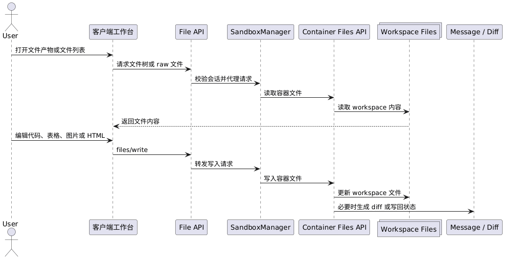

**图 6-3　文件预览、编辑与写回时序（沿用旧版飞书图，按当前 main 分支概念复核）**

1. 前端根据会话和文件路径请求文件树或 Raw 内容；
2. Core 校验会话所有权并定位 Sandbox session；
3. Host Manager 代理到 Container Files API；
4. Workbench 根据类型选择编辑器；
5. 修改通过 `files/write` 写回当前工作区；
6. 跨会话迁移先执行 preview，返回路径映射、冲突和跳过项；
7. 用户确认后再复制到目标会话。

### 6.8 HTML 与服务预览数据流

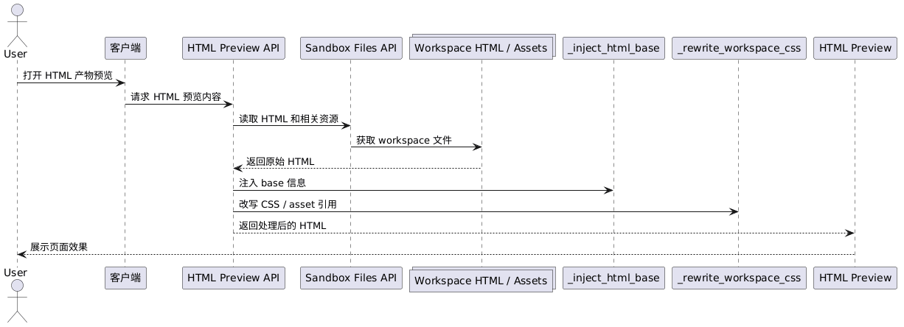

**图 6-4　HTML 预览与 Workspace 资源代理时序（沿用旧版飞书图，按当前 main 分支概念复核）**

HTML 文件预览：

```text
读取 Sandbox HTML
→ 注入安全 base
→ 改写 workspace CSS/asset 路径
→ 通过后端返回处理后的内容
→ 前端安全预览
```

长运行服务预览：

```text
Agent 启动服务
→ ServiceManager 登记命令、端口和日志
→ 上报 service 元素
→ Host 生成受控代理路径和 Token
→ 用户访问、查看日志、停止或重启
```

### 6.9 Capability 投影与调用数据流

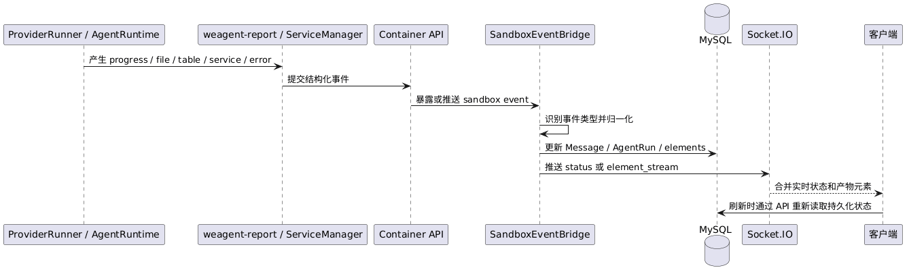

**图 6-5　Capability 投影与调用时序（沿用旧版飞书图，按当前 main 分支概念复核）**

```text
Capability 导入/创建
→ 创建不可变版本和资产
→ 安全审查
→ AgentCapabilityBinding
→ 会话创建/恢复时构建 Projection
→ 写入 /workspace/.weagent
→ AgentRuntime 读取
→ Tool/MCP 调用
→ CapabilityCallRecord
```

### 6.10 领域服务调用数据流

通用调用链：

```text
领域页面或 Agent
→ Core Domain Proxy / Sandbox call_service_api
→ RD、Office 或 RAG 服务
→ 领域权限与 Workspace 校验
→ 领域数据库
→ 返回结构化对象
→ Message Element 或业务页面
```

Education 可信写回链：

```text
用户自然语言目标
→ Education 会话绑定与实时成员角色
→ 指定 Education Agent
→ education_action
→ Tool Gateway 校验 Grant、动作、Agent 和幂等键
→ 写入 Canonical Education Object
→ 记录 EducationToolCall
→ 生成 education_card
→ 聊天与业务页面双向跳转
```

### 6.11 RAG 入库数据流

```text
上传文件 / URL / 网页
→ Document 草稿与原文件
→ 文本解析和预览
→ Confirm / Reprocess
→ Chunk
→ Embedding
→ SQLite Vector Store
→ Document 状态更新
```

### 6.12 RAG 检索数据流

```text
Agent rag_search 或客户端搜索
→ 服务端解析 SearchScope
→ 过滤 domain / workspace / owner / visibility / document_ids
→ 向量检索
→ 可选关键词混合排序
→ 返回来源、Chunk、分数和定位
→ Agent 基于证据回答
```

RAG 返回的是证据片段，不是领域业务数据库的替代品。查询项目状态、课程成员或审批结果时，应优先调用对应领域服务；只有需要文档知识时才使用 RAG。

### 6.13 正式业务写回与临时文件边界

系统应使用以下判定：

- 只存在于 `/workspace` 的文件属于临时执行产物；
- 写入 `Message.elements` 可以恢复展示，但不一定成为领域业务对象；
- 写入 RD、Education、Office 数据库后才成为正式业务事实；
- Education 产品型任务还要求存在受审计的成功工具调用；
- 原始上传资料需要持久目录或对象存储，不能仅依赖会话容器。

## 7. 开发者部署与运行

WeAgent 由多个进程和 Docker Sandbox 共同组成。开发部署的核心不是“启动一个后端”，而是保证 Core、四个独立服务、数据库、Redis、Docker 镜像和客户端使用一致的认证与地址配置。

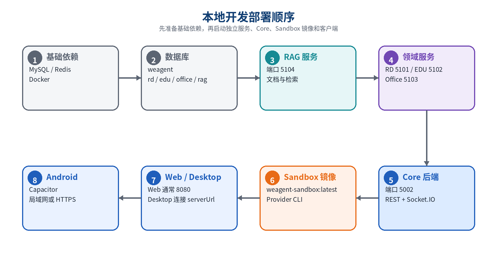

**图 7-1　WeAgent 本地开发环境的依赖与推荐启动顺序**

### 7.1 环境要求

| 组件 | 建议或代码要求 | 用途 |
|---|---|---|
| Python | 3.10+ | Core、RD、Education、Office 和 RAG 服务 |
| Node.js | 18+ | Web、Desktop 和 Android 构建 |
| MySQL | 8.x | Core 和四个独立服务的业务元数据 |
| Redis | 7.x 或兼容版本 | Core 和领域服务的辅助基础设施 |
| Docker Desktop / Docker Engine | 支持 Docker API | 构建并运行每会话 Sandbox |
| Android Studio / Gradle | 仅 Android 构建需要 | Capacitor Android 工程 |
| Provider CLI | 按所选 Adapter 安装在 Sandbox 镜像中 | Claude Code、Codex、OpenCode |

`backend/requirements.txt` 还包含文档与多媒体处理依赖，例如 `python-docx`、`python-pptx`、`reportlab`、`pypdf`、RapidOCR、ONNX Runtime 和 OpenCV。这些依赖服务于文件解析、课件和报告等能力。

### 7.2 服务与数据库规划

| 服务 | 默认端口 | 独立数据库 | 启动入口 |
|---|---:|---|---|
| Core Backend | 5002 | `weagent` | `backend/run.py` |
| RD Service | 5101 | `weagent_rd` | `backend/services/rd/main.py` |
| Education Service | 5102 | `weagent_edu` | `backend/services/edu/app.py` |
| Office Service | 5103 | `weagent_office` | `backend/services/office/app.py` |
| RAG Service | 5104 | `weagent_rag` | `backend/services/rag/app.py` |
| Web | 通常 8080 | 无 | `frontend/` |
| Desktop Dev Server | Vite 默认 5173 | 无 | `clients/desktop/` |

所有服务使用同一个 `JWT_SECRET_KEY`，否则 Core 转发的用户 Token 无法被领域服务验证。Education 与 RAG 之间还需要一致的 `RAG_INTERNAL_API_KEY/INTERNAL_API_KEY`。

### 7.3 数据库准备

至少需要创建：

```sql
CREATE DATABASE weagent CHARACTER SET utf8mb4 COLLATE utf8mb4_unicode_ci;
CREATE DATABASE weagent_rd CHARACTER SET utf8mb4 COLLATE utf8mb4_unicode_ci;
CREATE DATABASE weagent_edu CHARACTER SET utf8mb4 COLLATE utf8mb4_unicode_ci;
CREATE DATABASE weagent_office CHARACTER SET utf8mb4 COLLATE utf8mb4_unicode_ci;
CREATE DATABASE weagent_rag CHARACTER SET utf8mb4 COLLATE utf8mb4_unicode_ci;
```

Core 使用 Flask-SQLAlchemy 和 Flask-Migrate，并包含针对已有表的兼容字段迁移逻辑。领域服务的初始化方式并不完全一致：部分服务会在启动时创建数据库或执行 `db.create_all()`，部分还提供 `sql/init.sql`。正式部署不应只依赖开发期自动迁移，建议将 Schema 版本纳入明确的发布流程。

### 7.4 Core 后端启动

PowerShell 示例：

```powershell
cd backend
python -m venv venv
.\venv\Scripts\Activate.ps1
pip install -r requirements.txt
Copy-Item .env.example .env
python run.py
```

Linux/macOS 示例：

```bash
cd backend
python3 -m venv venv
source venv/bin/activate
pip install -r requirements.txt
cp .env.example .env
python run.py
```

Core `.env` 的关键项：

```env
PORT=5002
MYSQL_HOST=localhost
MYSQL_PORT=3306
MYSQL_USER=root
MYSQL_PASSWORD=<password>
MYSQL_DB=weagent
REDIS_HOST=localhost
REDIS_PORT=6379
JWT_SECRET_KEY=<shared-random-secret>
SECRET_KEY=<another-random-secret>
DOMAIN_PROXY_TIMEOUT_SECONDS=180
```

`DOMAIN_PROXY_TIMEOUT_SECONDS` 需要覆盖 Education 新会话可能触发的 Sandbox 创建与健康检查时间，但不应无限增大；连接超时仍应被识别为领域服务不可达。

### 7.5 RD、Education、Office 和 RAG 启动

每个服务应复制自己的 `.env.example`，并将 JWT 密钥与 Core 对齐。

```powershell
# RD
cd backend/services/rd
python main.py

# Education
cd backend/services/edu
python app.py

# Office
cd backend/services/office
python app.py

# RAG
cd backend/services/rag
python app.py
```

推荐启动顺序：

1. MySQL、Redis 和 Docker；
2. RAG；
3. RD、Education、Office；
4. Core；
5. 构建 Sandbox 镜像；
6. Web、Desktop 或 Android。

RAG 先于 Education 启动，可以减少 Education 资料入库时的降级。RD 和 Office 不依赖 RAG 才能启动，但需要 RAG 时应通过服务健康检查明确状态。

### 7.6 RAG 配置说明

RAG 运行时关键配置形状如下。当前 `config.py` 的默认 Embedding Provider 为 `local`；仓库 `.env.example` 中同时保留了外部 Embedding 和 Chroma/Milvus 的候选配置。

```env
RAG_PORT=5104
RAG_DATABASE_URL=mysql+pymysql://.../weagent_rag?charset=utf8mb4
JWT_SECRET_KEY=<same-as-core>
INTERNAL_API_KEY=<service-internal-key>
REDIS_URL=redis://127.0.0.1:6379/0
EMBEDDING_PROVIDER=local
EMBEDDING_MODEL=local-hash-embedding-v1
EMBEDDING_API_KEY=
EMBEDDING_BASE_URL=http://localhost:11434
```

当前代码的向量事实源是 `SimpleVectorStore` 和 SQLite。`VECTOR_STORE_TYPE=chromadb`、Chroma/Milvus 地址在配置中属于后续接入占位；除非后续完成对应 Vector Store Adapter 并重新验证，否则部署时不需要启动 ChromaDB 或 Milvus。

### 7.7 Education 持久文件配置

Education 上传的 PDF、Word、图片和生成资产不能只保存于会话 Sandbox。部署时需要为 Education 上传目录配置持久卷或对象存储，并确保：

- Education 数据库保存文件元数据；
- 原文件在服务重启、Sandbox 销毁后仍可访问；
- RAG Document 能够追溯原始来源；
- 文件下载和预览继续执行课程成员权限校验。

### 7.8 Sandbox 镜像构建

```powershell
cd backend
docker build -t weagent-sandbox:latest -f app/sandbox/Dockerfile app/sandbox
```

镜像需要包含：

- Python/Node 等基础运行环境；
- Container Server 和 Orchestrator；
- `weagent-report`、服务管理脚本和工具运行时；
- Claude Code、Codex、OpenCode 中实际需要的 CLI；
- Provider 运行所需的系统依赖。

每次修改 Container 代码、Provider CLI 或系统依赖后都需要重新构建镜像。只重启 Core 不会自动更新已有镜像。

### 7.9 Web 启动与构建

```powershell
cd frontend
npm install
npm run serve
```

生产构建：

```powershell
npm run build
```

Web 需要配置可访问的 Core 地址。REST API 与 Socket.IO 必须指向同一部署环境，否则会出现“历史消息能加载但实时进度不更新”的问题。

### 7.10 Desktop 启动与构建

```powershell
cd clients/desktop
npm install
npm run dev
```

安装包构建：

```powershell
npm run electron:build
```

Desktop 不内置 Core 后端。用户配置的 `serverUrl` 同时影响 REST 和 Socket.IO；部署文档应要求先通过 `/api/health` 验证地址，而不是只检查页面是否打开。

### 7.11 Android 启动与构建

```powershell
cd clients/android
npm install
npm run build
npx cap sync android
npx cap open android
```

真机不能使用电脑端的 `localhost`。本地调试应使用电脑局域网 IP，并检查 Android 明文 HTTP、证书和防火墙配置；正式环境建议通过 HTTPS 暴露 Core。

### 7.12 Provider 配置与凭据边界

用户的模型配置保存在 `UserModelConfig`，Core 通过 `SettingsService` 转换为容器环境变量。常见变量包括：

- `ANTHROPIC_API_KEY`、`ANTHROPIC_BASE_URL`、`ANTHROPIC_MODEL`；
- `CODEX_API_KEY`、`CODEX_BASE_URL`、`CODEX_MODEL`、`CODEX_USE_RELAY`；
- OpenCode 对应的 API Key、Base URL 和模型；
- Provider 认证文件或配置文本。

凭据只应在受控设置和容器运行环境中使用，不应写入 Markdown、Message Element、Raw Output 或 Git 仓库。

### 7.13 基础健康检查

| 检查项 | 示例入口 |
|---|---|
| Core | `GET http://localhost:5002/api/health` |
| RD | `GET http://localhost:5101/api/rd/health` |
| Education | `GET http://localhost:5102/api/edu/health` |
| Office | `GET http://localhost:5103/api/office/health` 或 Spec 端点 |
| RAG | `GET http://localhost:5104/api/rag/health` |
| Sandbox 镜像 | `docker image ls weagent-sandbox` |
| 活跃 Sandbox | `docker ps --filter label=weagent.managed=true` |

健康检查只能说明进程和基本依赖状态，不代表完整 Agent 任务、领域权限或产物编辑已经验证。

### 7.14 测试入口的文档边界

技术文档可以记录稳定入口：

```powershell
cd backend
python -m pytest -q
```

前端 `package.json` 当前没有统一 `test` script，`frontend/tests/*.test.js` 是独立的 Node 契约测试。正文不记录某次执行通过多少用例；通过数量应进入与 commit 绑定的 CI 或验收报告。

---

## 8. 关键接口与数据模型

WeAgent 的 HTTP 接口分为三层：**客户端访问的 Core API、Core 转发的 Domain API、宿主后端访问的 Container API**。理解这三层可以避免前端绕过权限边界直接访问容器或领域服务。

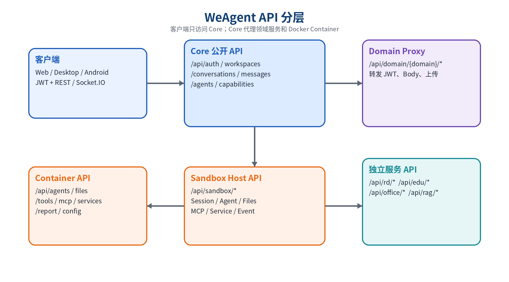

**图 8-1　Core API、Domain Proxy、Sandbox Host 与 Container API 分层**

### 8.1 Core API 分组

| 接口域 | 主要前缀 | 作用 |
|---|---|---|
| 认证与用户 | `/api/auth`、`/api/user-directory` | 登录、注册、Profile、Token 和用户搜索 |
| Workspace | `/api/workspaces` | 工作空间、成员、归档和永久删除 |
| 会话 | `/api/conversations` | 会话、参与者、收藏、附件、停止和预检 |
| 消息 | `/api/messages` | 发送、历史、置顶、轮询和 SSE 降级读取 |
| Agent | `/api/agents` | Agent 和分类管理 |
| Capability | `/api/capabilities`、`/api/agents/<id>/capabilities` | 能力导入、版本、审计、绑定和 Provider Config |
| Artifact | `/api/artifacts` | 可复用 Artifact 的创建、读取和更新 |
| Settings | `/api/settings` | 模型和 Provider 配置 |
| Toolset/旧 Tool | `/api/toolsets`、`/api/tools` | 工具集分类和兼容工具入口 |
| Grayscale | `/api/grayscale`、`/api/admin/grayscale` | 领域功能开关 |
| Domain Proxy | `/api/domain/<domain>` | 代理四个独立服务 |
| Sandbox | `/api/sandbox` | 镜像、session、Agent、文件、MCP、服务和事件 |

### 8.2 Domain Proxy 行为

`/api/domain/<domain>/<subpath>` 支持 GET、POST、PUT、DELETE 和 PATCH，并执行：

1. 检查领域映射是否存在；
2. 对需要鉴权的请求执行 `jwt_required()`；
3. 检查 Education 灰度开关；
4. 转发查询参数、Body 和认证 Header；
5. 对 multipart 上传单独转发文件与表单；
6. 过滤连接相关响应头；
7. 将连接失败或超时转换为 502。

Domain Proxy 是客户端统一入口，不负责解释领域业务规则。权限、成员关系和对象可见性仍由领域服务处理。

### 8.3 RD API 分组

| 分组 | 主要路由 |
|---|---|
| 服务发现 | `/api/rd/spec`、`/api/rd/health` |
| 项目 | `/api/rd/projects`、项目详情、文件、上下文、甘特图 |
| 迭代 | 项目下 iterations 及独立 iteration 状态接口 |
| 需求 | 项目下 requirements、状态流转、迭代移动、负责人 |
| Bug | 项目下 bugs、状态流转、负责人和关联信息 |
| 协作 | comments、members、activities |
| GitHub/仓库 | OAuth 配置、授权、Token、repos、branches、commits、tree、diff、file |
| Review | reviews、retry、auto-fix、issue 状态 |
| Build | builds、步骤、日志和 GitHub Actions 集成入口 |

RD 的 `workspace_id` 和 `project_id` 是主要范围字段。GitHub Token 和 OAuth Secret 属于敏感数据，模型中虽保存对应字段，但技术文档不提供真实值。

### 8.4 Education API 分组

Education 通过多个 Blueprint 统一注册在 `/api/edu`：

| 分组 | 作用 |
|---|---|
| Course/Member | 课程、成员、角色、邀请和成员资料 |
| Content | 课程单元、课时、教案、课件、作业、提交、反馈和版本 |
| Assets | 领域文件上传、持久化和资源访问 |
| Knowledge | 题库、试卷、刺激材料、答案版本和知识资源 |
| Learning | 模拟考试、弱点、思维导图和学生学情 |
| Workflow | 产品型 Agent 运行、协作流程和状态 |
| Tools | RunGrant、`education_action` 和调用审计 |
| Conversation | Education 会话绑定、上下文和恢复 |

Education API 的完成语义以正式业务写入为准。聊天文本、临时文件或 Provider 的“已完成”声明不能代替 Canonical Education Object。

### 8.5 Office API 分组

| 分组 | 前缀和能力 |
|---|---|
| Meetings | `/api/office/meetings`：会议、确认、纪要和行动项 |
| Schedules | `/api/office/schedules`：日程、更新和冲突检查 |
| Documents | `/api/office/documents`：公文、从会议生成、提交、发布和签收 |
| Templates | `/api/office/document-templates`：模板 CRUD |
| Approvals | `/api/office/approvals`：查询、批准、拒绝和撤回 |
| Organization | `/api/office/organization`：组织、部门、小组、成员和通知 |
| Service Spec | `/api/office/spec`：Agent 服务发现 |

Office Agent 对写操作的提示要求先向用户复述影响并取得明确确认。该约束目前主要体现在 Agent 运行说明中；真正的业务授权仍应由 Office 服务的角色和对象规则承担。

### 8.6 RAG API 分组

| 分组 | 路由 | 作用 |
|---|---|---|
| 文档导入 | `/api/rag/documents/upload`、`fetch-url`、`scrape-url` | 文件、下载和网页采集 |
| 文档生命周期 | preview、confirm、reprocess、delete、list、detail | 草稿、确认、索引和删除 |
| 语义检索 | `/api/rag/search` | 向量检索和范围过滤 |
| 混合检索 | `/api/rag/search/hybrid` | 语义与关键词综合 |
| 状态与发现 | `/api/rag/health`、`/api/rag/status`、`/api/rag/spec` | 服务、数据库、向量和能力信息 |

搜索请求可以包含 query、top_k、domain 和 document_ids，但最终 SearchScope 由服务端认证上下文解析，不能把客户端过滤器当成唯一权限控制。

### 8.7 Sandbox Host API

Sandbox Host API 主要包括：

- 镜像状态和构建；
- session 创建、查询、列表和销毁；
- Agent 添加、删除、发送、链式执行、停止、历史和事件；
- 文件树、Raw、下载、ZIP、写回和迁移；
- Tool 安装与删除；
- MCP Server 启动、列工具、调用和停止；
- Service 启动、停止、重启、日志、Token 和代理；
- 容器事件回调。

这些路由先校验用户和会话，再访问 Container API。客户端不应直接连接容器映射端口。

### 8.8 Container API

Container Server 暴露内部 `/api/*`，包括：

- `/api/agents/*`：AgentRuntime 和任务委派；
- `/api/files/*`：工作区文件；
- `/api/tools/*`：工具执行和自定义工具；
- `/api/mcp/*`：MCP Runtime；
- `/api/services/*`：长运行服务；
- `/api/report`：结构化产物上报；
- `/api/config/*`：KB、模型和运行配置热更新；
- `/api/capabilities/projection`：能力投影。

Container API 是 Host 与容器之间的内部协议，不能作为公开客户端 API 使用。

### 8.9 Core 关键数据模型

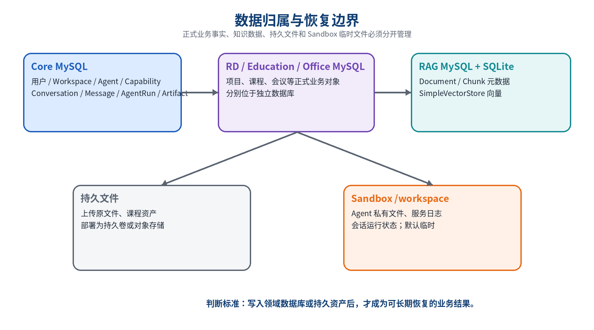

**图 8-2　Core、三个领域、RAG、持久文件与 Sandbox 的数据归属**

| 模型 | 关键字段 | 边界 |
|---|---|---|
| `User` | 用户名、头像、角色 | 身份与平台权限 |
| `Workspace` | `domain`、`sub_role`、名称、状态 | 领域工作空间，不保存领域全部业务对象 |
| `WorkspaceMember` | workspace、user | 工作空间成员关系 |
| `Agent` | adapter、system prompt、skill、domain | 全局 Agent 定义 |
| `Capability` | type、domain、source、latest version | 能力元数据和版本入口 |
| `AgentCapabilityBinding` | Agent、版本、权限快照 | 决定 Agent 可见能力 |
| `Conversation` | workspace、domain、services、sandbox_*、project_id | 会话与运行环境绑定 |
| `Message` | content、elements、status、raw_output、round/run | 用户可见消息和结构化结果 |
| `AgentRun` | agent、session、status、last_seq、error | 单个执行实例 |
| `Artifact` | type、content、preview、version | 部分可复用产物，不是所有输出 |
| `GrayscaleConfig` | domain、config key、enabled | 领域功能开关 |

### 8.10 RD 关键数据模型

| 模型组 | 对象 |
|---|---|
| 项目与成员 | `RdProject`、`RdProjectMember`、`RdProjectFile` |
| 计划与需求 | `RdIteration`、`RdRequirement`、`RdRequirementAssignee` |
| 缺陷 | `RdBug`、`RdBugAssignee` |
| 代码仓库 | `RdGithubOAuthConfig`、`RdGithubToken`、`RdRepo`、`RdBranch` |
| 代码审查 | `RdReview`、`RdReviewIssue` |
| 构建 | `RdBuild`、`RdBuildStep` |
| 协作 | `RdComment`、`RdActivityLog` |

`RdProject.workspace_id` 将 RD 项目关联到 Core Workspace，但两者位于不同数据库，不能依赖数据库外键完成跨库一致性。

### 8.11 Education 关键数据模型

Education 模型数量较多，可按业务生命周期理解：

| 生命周期 | 主要模型 |
|---|---|
| 课程与成员 | `Course`、`CourseMembership`、`CourseMemberProfile`、`CourseInvitation` |
| 教学设计 | `CourseUnit`、`Lesson`、`LessonActivity`、`PublishedLessonVersion` |
| 内容与课件 | `EducationContent`、`EducationContentVersion`、`EducationMaterial`、`EducationAsset` |
| 作业与反馈 | `Assignment`、版本、导入任务、`Submission`、`Feedback`、Review Draft |
| 知识与测评 | Assessment Item/Paper/Stimulus 及版本、`KnowledgeResource` |
| 学习产品 | `MockExamAttempt`、`WeaknessAnalysisSnapshot`、`CourseMindMap`、`StudentInsightSnapshot` |
| Agent 运行 | `EducationWorkflow`、`EducationAgentRun`、`EducationConversationBinding` |
| 可信工具 | `EducationToolGrant`、`EducationToolCall` |

### 8.12 Office 关键数据模型

| 模型 | 作用 |
|---|---|
| `OfficeDepartment`、`OfficeGroup`、`OfficeMember` | 组织和成员关系 |
| `OfficeNotification` | 业务通知及已读状态 |
| `Meeting` | 会议主题、时间、参与者、材料和状态 |
| `ActionItem` | 会议行动项、负责人和完成状态 |
| `Schedule` | 日程、任务、会议、公文关联和冲突判断 |
| `OfficialDocument` | 公文内容、状态、收件人和审批人 |
| `DocumentTemplate` | 公文模板 |
| `DocumentReceipt` | 签收记录 |
| `Approval` | 审批状态和处理记录 |

### 8.13 RAG 数据模型和向量边界

`Document` 保存文档级元数据和访问属性；`Chunk` 保存可检索片段及来源定位；向量由 `SimpleVectorStore` 保存到 SQLite。删除或重处理文档时，需要同时协调：

- MySQL Document/Chunk；
- 向量记录；
- 原文件；
- 领域服务中的资源关联。

### 8.14 关键模型边界

| 容易混淆的对象 | 正确理解 |
|---|---|
| Workspace 与 RD Project | Workspace 是通用领域空间；Project 是 RD 业务对象 |
| Conversation 与 Education Binding | Conversation 保存通用会话；Binding 保存课程和角色上下文 |
| Message Element 与 Artifact | Element 是消息展示核心；Artifact 只覆盖部分可复用产物 |
| Raw Output 与最终结果 | Raw Output 用于恢复和排障，不是唯一用户结果 |
| Sandbox File 与 Business Object | Sandbox 文件是执行产物；领域数据库对象才是正式业务事实 |
| Agent Adapter 与 Tool Provider | 前者选择 AI CLI，后者配置某个工具的外部 Provider |
| RAG 文档与领域记录 | RAG 保存知识证据；项目、作业、公文状态仍从领域服务读取 |

### 8.15 最小请求示例

发送消息：

```http
POST /api/messages
Authorization: Bearer <access_token>
Content-Type: application/json

{
  "conversation_id": "<conversation_id>",
  "content": "分析当前项目的高优先级缺陷并给出修复顺序。",
  "message_type": "text",
  "target_agent_ids": ["<agent_id>"],
  "agent_configs": {
    "<agent_id>": {
      "enabled": true,
      "adapter_name": "codex"
    }
  },
  "workflow": null
}
```

该 HTTP 响应只表示任务已提交。最终结果通过 Socket.IO、消息列表、文件 API 和 Service API逐步恢复。

---

## 9. 运行风险与常见故障

WeAgent 的故障通常跨越多个进程。正确策略是从基础依赖向上排查，而不是先修改前端组件或反复重发消息。

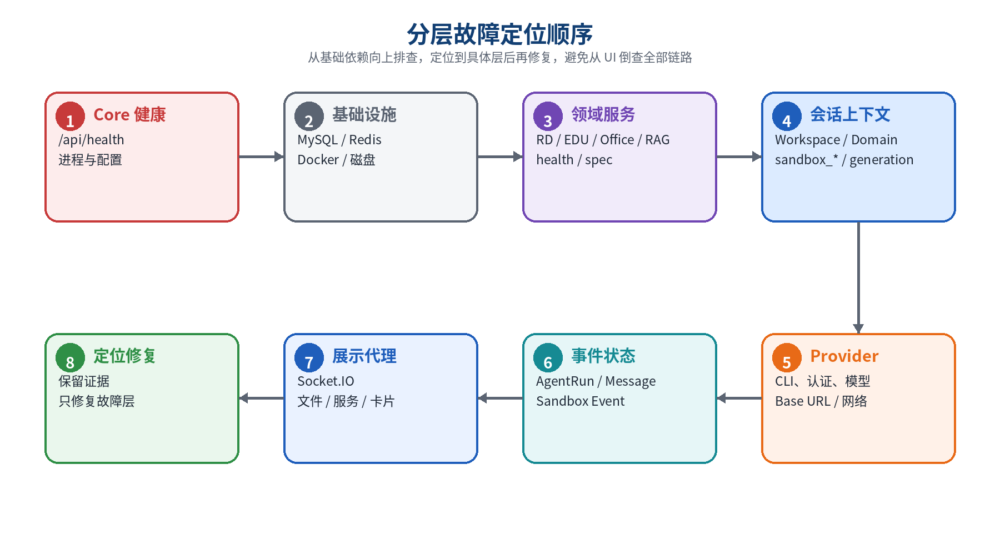

**图 9-1　从 Core 健康状态到前端展示的分层故障定位顺序**

### 9.1 建议排障顺序

1. Core `/api/health`；
2. MySQL、Redis、Docker 和磁盘；
3. RD、Education、Office、RAG 健康检查；
4. Conversation 的 Workspace、Domain 和 `sandbox_*`；
5. Sandbox 镜像、Container Server 和 Provider CLI；
6. `AgentRun`、Sandbox Event、`Message.elements/raw_output`；
7. Socket.IO、文件代理、服务代理和前端渲染。

### 9.2 Core 与基础设施

| 症状 | 常见原因 | 检查 | 处理 |
|---|---|---|---|
| Core 无法启动 | `.env`、MySQL、Redis、端口或依赖错误 | 后端日志、数据库连接、5002 占用 | 修正配置后重启 |
| `/api/health` 不通 | 进程未运行、防火墙或地址错误 | 本机 curl/浏览器、监听端口 | 统一部署地址并开放端口 |
| 登录后领域请求 401 | JWT Secret 不一致或 Token 过期 | 比较 Core 与领域 `.env` | 对齐密钥并重新登录 |
| Domain Proxy 502 | 对应领域服务未启动、超时或端口错误 | 直接访问领域 health/spec | 启动服务或修正映射 |
| 数据表字段错误 | 数据库 Schema 与代码不一致 | SQL 错误、迁移记录 | 执行受控迁移，不直接删除数据 |

### 9.3 Workspace、领域和权限

| 症状 | 根因 | 处理 |
|---|---|---|
| 工作空间列表为空 | 用户不是创建者或成员，或 domain 过滤错误 | 检查 `WorkspaceMember` 和请求 domain |
| RD 项目不可见 | `workspace_id` 不一致或项目成员权限不足 | 对照 Core Workspace 和 `RdProject.workspace_id` |
| Education 课程上下文不存在 | Core 会话已创建但 Binding 未持久化，或课程成员已变化 | 先写 Binding 再 runtime preflight，并重新校验 CourseMembership |
| Office 数据跨工作空间 | Controller/Service 未正确应用 `workspace_id` | 检查查询条件和用户身份 |
| Agent 看到错误服务 | `sandbox_agent_service_views` 未更新或团队并集被错误下发 | 重新计算单 Agent Service View |

### 9.4 Sandbox 与 Provider

| 症状 | 常见原因 | 检查 | 处理 |
|---|---|---|---|
| 创建会话提示镜像不存在 | 未构建 `weagent-sandbox:latest` | `docker image ls` | 重新构建镜像 |
| Sandbox session 失败 | Docker 未运行、端口或 Container Server 启动失败 | Docker 日志、`sandbox_status` | 启动 Docker、重建镜像或新建 session |
| Provider CLI 不存在 | 镜像缺少 CLI 或 PATH 错误 | 进入容器执行命令 | 修正 Dockerfile 并重建 |
| Provider 认证失败 | API Key、Base URL、模型、认证文件或 Relay 错误 | `raw_output`、stderr | 修正用户模型配置 |
| 任务长期 running | Provider 卡住、事件未回传或停止请求失效 | AgentRun、容器进程、事件序号 | 停止 Agent，保留错误后重试 |
| 恢复到旧容器状态 | generation、snapshot 或 session 绑定不一致 | Conversation `sandbox_*` | 按 generation 重新创建或恢复 |

### 9.5 消息与事件

| 症状 | 常见原因 | 处理 |
|---|---|---|
| 前端无进度但任务实际执行 | 未加入 Socket room 或 REST/Socket 地址不一致 | 重新连接并检查浏览器网络 |
| 刷新后产物消失 | 事件只存在客户端内存，未写入 `elements/raw_output` | 修复 Event Bridge 持久化 |
| 同一元素重复出现 | 事件 ID/序号去重失败 | 检查 `AgentRun.last_seq` 和 element ID |
| Message done 但 AgentRun running | 两类状态只更新了一方 | 在完成/错误事件中同步更新 |
| Raw Output 很长但没有用户结果 | Provider 输出未转换成 result/element | 检查解析器和事件类型映射 |

### 9.6 Capability、工具和 MCP

| 症状 | 常见原因 | 处理 |
|---|---|---|
| Agent 看不到已绑定能力 | 投影未生成、绑定禁用或版本无效 | 检查 Binding、Projection 和 `.weagent` |
| Tool 要求配置 | `ToolProviderConfig` 缺失或状态无效 | 在能力配置页测试并启用 Provider |
| MCP 启动失败 | manifest、命令、依赖或权限错误 | 查看 MCP Runtime 错误和调用记录 |
| 工具调用跨领域 | Service View 或 domain 过滤不正确 | 限制当前 Agent 的服务和 Capability |
| Education 写入被拒绝 | 使用了通用 API、Grant 过期或动作不在白名单 | 使用 `education_action` 并重新签发 Grant |

### 9.7 RAG 与文件处理

| 症状 | 常见原因 | 处理 |
|---|---|---|
| 文档一直处于草稿 | 未执行 confirm 或解析失败 | 查看 preview/处理状态后确认或重处理 |
| 检索无结果 | 文档未索引、Scope 过窄、阈值过高或向量缺失 | 检查 Document、Chunk、SQLite 向量和 SearchScope |
| 检索到其他领域内容 | domain/workspace/visibility 未正确过滤 | 修复服务端 SearchScope，不能仅依赖客户端 |
| Education PDF 上传后不可检索 | Education 入库开关、RAG URL 或 Internal Key 错误 | 检查两个服务环境变量 |
| 网页抓取失败 | URL 安全校验、重定向、网络或解析器限制 | 查看 scraper 错误，不绕过安全限制 |
| 删除文档后仍命中 | MySQL 和向量记录未同步删除 | 协调删除 Document、Chunk 和 Vector |

### 9.8 文件与 HTML 预览

| 症状 | 常见原因 | 处理 |
|---|---|---|
| 文件 Network Error | session 失效、路径不规范或文件不存在 | 检查元素 path 和当前 Sandbox |
| 表格卡片打不开 | 数据仅内联在 element，不存在物理文件 | 直接渲染 columns/rows |
| HTML 无样式 | 相对资源未改写或代理地址错误 | 检查 base 注入和 workspace URL |
| HTML 返回未授权 | iframe 直接访问受保护接口 | 使用认证请求、Blob 或签名资源 |
| 服务预览打不开 | 服务未启动、Token 过期或端口映射错误 | 查看 ServiceManager 状态和日志 |
| 会话迁移覆盖文件 | 未执行 preview 或冲突策略错误 | 先预览，再由用户确认迁移 |

### 9.9 数据一致性与恢复

- Core 会话存在但领域对象不存在：检查业务写回是否成功，不要从聊天文本推断完成；
- 领域对象存在但卡片显示失败：检查工具审计、Grant 和当前事务是否看到最新提交；
- Sandbox 销毁后业务数据丢失：说明正式结果错误地只保存于 `/workspace`；
- 历史卡片仍显示无权对象：读取时应重新校验当前成员和可见性；
- RAG 元数据存在但原文件丢失：上传目录没有持久化或备份；
- 跨数据库关联失效：Core 与领域数据库之间没有真实外键，需要通过服务逻辑和审计修复。

### 9.10 生产部署需额外完善的方面

当前仓库能够说明本地和单机部署入口，但生产环境还需要独立设计：

- 反向代理、HTTPS、CORS 和 WebSocket；
- Secret Manager 和凭据轮换；
- 数据库迁移、备份和恢复；
- 上传文件的对象存储和生命周期；
- Sandbox 资源配额、网络策略和镜像供应链；
- 日志集中化、指标、追踪和告警；
- 多机容器调度和会话粘性；
- RAG 向量库扩容方案；
- 审计日志保留和敏感数据脱敏。

这些属于生产化扩展要求，不能在尚无代码或部署配置支撑时描述为当前已实现能力。

## 10. 三个领域的实现

WeAgent 的领域扩展建立在通用 Agent 平台之上，但领域服务并不是 Core 内部的一组页面或表。RD、Education、Office 都拥有独立 Flask 服务和独立业务数据库，通过 Workspace、Domain Proxy、Service View、Sandbox 和 RAG 与通用平台连接。

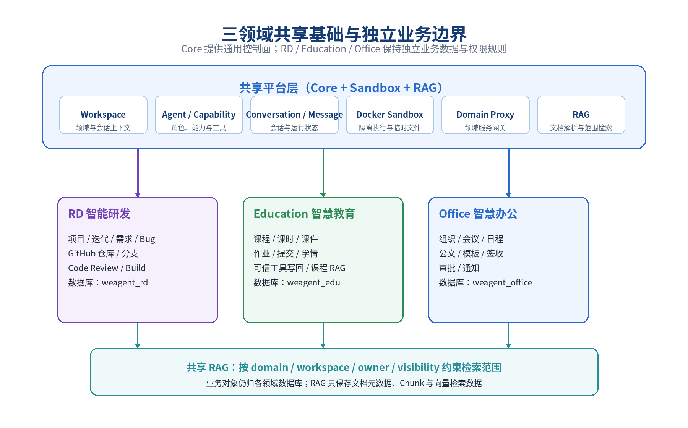

**图 10-1　三领域共享基础与独立业务边界**

从工程角度看，三个领域共同复用以下基础能力：

- Core 用户、Workspace、Conversation、Message、Agent 和 Capability；
- `/api/domain/<domain>/*` 领域代理；
- Docker Sandbox 隔离执行环境；
- `SERVICE_REGISTRY`、Service View 与 `list_services` / `call_service_api`；
- RAG 文档、Chunk、Embedding 和范围检索；
- Web 的领域入口与通用会话工作台。

领域自己的业务事实则保存在独立数据库中。这样的拆分使通用 Agent 能力可以复用，同时避免把研发需求、课程作业和办公审批混入同一套业务表。

### 10.1 共同领域基础

#### 10.1.1 Workspace 是领域入口，不是领域数据库

Core 的 `Workspace` 模型使用 `domain` 标记 `rd`、`edu` 或 `office`。会话通过 `Conversation.workspace_id` 进入对应业务上下文，并可附带 `kb_domain`、`project_id`、`services` 和 `sandbox_agent_service_views` 等运行信息。

Workspace 解决的是“当前用户正在什么业务空间里工作”，而不是替代领域对象：

- RD 的项目和需求仍在 `weagent_rd`；
- Education 的课程、课件和作业仍在 `weagent_edu`；
- Office 的会议、公文和审批仍在 `weagent_office`。

#### 10.1.2 Domain Proxy 提供统一入口

Core 的 `backend/app/controllers/domain_proxy_controller.py` 将：

```text
/api/domain/rd/*      → 127.0.0.1:5101/api/rd/*
/api/domain/edu/*     → 127.0.0.1:5102/api/edu/*
/api/domain/office/*  → 127.0.0.1:5103/api/office/*
/api/domain/rag/*     → 127.0.0.1:5104/api/rag/*
```

请求的方法、查询参数、JSON 请求体、认证信息和 multipart 文件由 Core 代理到对应服务。客户端因此不需要自行管理多个领域服务地址。

#### 10.1.3 Agent 使用 Service View 发现服务

Core 在创建或恢复 Sandbox 时，将允许服务写入会话运行环境。容器中的 Agent 可以使用：

- `list_services`：查看当前 Agent 可见的服务；
- `call_service_api`：调用已登记服务的受控 API；
- `rag_search`：通过 RAG 服务执行范围受限的知识检索；
- Education 专用 `education_action`：执行受授权的教育业务写操作。

Service View 是 Agent 的运行视图，不等于领域数据库权限本身。领域服务仍需使用 JWT、Workspace 所有权、课程成员关系或领域专用授权进行二次校验。

#### 10.1.4 RAG 按领域和上下文隔离

通用 RAG 服务接受 `domain`、`workspace_id`、所有者、可见范围和文档白名单等条件。Core 会为 Sandbox 构造服务端可信的 RAG Scope，模型侧参数不能扩大该范围。

Education 的课程场景更严格：课程 ID 和教师/学生角色来自 Education 上下文，而不是模型自由指定。

### 10.2 RD 智能研发

RD 服务入口为 `backend/services/rd/main.py`，默认端口 `5101`，默认数据库 `weagent_rd`。服务以项目为主聚合对象，围绕研发计划、执行、代码仓库、审查和构建组织业务。

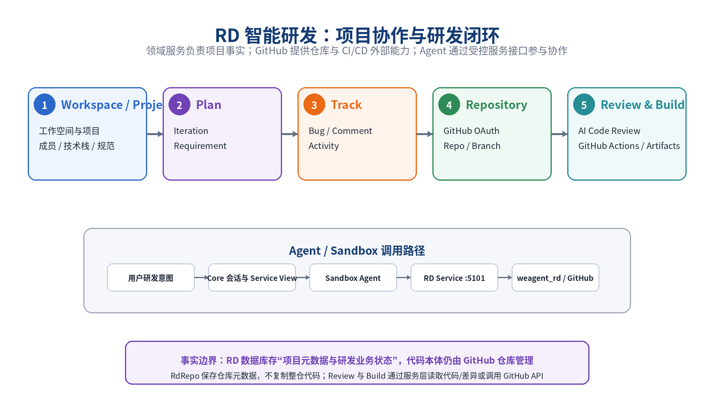

**图 10-2　RD 智能研发项目闭环**

#### 10.2.1 主要模块和对象

| 模块 | 核心对象 | 主要代码入口 |
|---|---|---|
| 项目 | `RdProject`、`RdProjectMember` | `controllers/project_controller.py`、`services/project_service.py` |
| 迭代 | `RdIteration` | `iteration_controller.py`、`iteration_service.py` |
| 需求 | `RdRequirement`、Assignee | `requirement_controller.py`、`requirement_service.py` |
| Bug | `RdBug`、Assignee | `bug_controller.py`、`bug_service.py` |
| 评论与活动 | `RdComment`、`RdActivityLog` | `comment_controller.py`、`activity_controller.py` |
| 仓库与分支 | `RdRepo`、`RdBranch`、GitHub Token | `repo_controller.py`、`branch_controller.py`、`github_service.py` |
| Code Review | `RdReview`、`RdReviewIssue` | `review_controller.py`、`review_service.py`、Review Engine |
| Build | `RdBuild`、`RdBuildStep` | `build_controller.py`、`build_service.py` |

RD 的 Service Spec 将能力描述为项目管理、需求管理、缺陷跟踪、迭代管理、代码仓库、代码审查、构建管理、成员协作和甘特图。

#### 10.2.2 Workspace 与项目边界

`RdProject.workspace_id` 将项目关联到 Core Workspace。项目内部再维护项目成员、需求、Bug、迭代和仓库关系。因此：

```text
Core Workspace
  → RD Project
      → Iteration / Requirement / Bug
      → Member / Comment / Activity
      → Repo / Branch / Review / Build
```

Workspace 是领域入口，Project 是研发业务主对象。一个研发 Workspace 可以组织项目级业务；实际项目数据由 RD 服务读取和写入。

#### 10.2.3 GitHub 集成边界

RD 支持 GitHub OAuth、仓库同步、文件树和分支访问，并可触发或读取 GitHub Actions 运行、Jobs、日志和 Artifacts。

`RdRepo` 保存的是 GitHub 仓库元数据，例如 `github_id`、`owner`、`repo_name`、`default_branch`、`clone_url` 和同步时间，**不把整个 Git 仓库复制到 RD 数据库**。代码内容仍以 GitHub 仓库为外部事实来源；RD 保存项目与仓库之间的业务关系和运行元数据。

#### 10.2.4 Agent 如何进入 RD

当会话位于 RD Workspace 或选择 RD 服务时，Core 会把 RD Service View 和项目上下文注入 Sandbox。Agent 可以先读取服务 Spec，再调用项目、需求、Bug、迭代、仓库、Review 或 Build API。

RD 查询结果可通过 `project_card`、`requirement_card`、`bug_card` 和 `iteration_card` 等结构化消息元素返回前端。Agent 不应该到 `/workspace` 文件目录中猜测研发业务数据；业务状态应通过 RD 服务读取。

#### 10.2.5 RD 的正式事实与临时执行数据

| 数据 | 权威位置 |
|---|---|
| 项目、迭代、需求、Bug、评论、成员 | `weagent_rd` |
| 仓库关联和 GitHub 元数据 | `weagent_rd` + GitHub |
| Review、ReviewIssue、Build、BuildStep | `weagent_rd` |
| GitHub 代码、Actions 日志和 Artifact | GitHub 外部系统 |
| Agent 临时分析文件、脚本 | Sandbox `/workspace` |
| 会话和结构化卡片 | Core MySQL `Message` / `Message.elements` |

### 10.3 Education 智慧教育

Education 服务入口为 `backend/services/edu/app.py`，默认端口 `5102`，默认数据库 `weagent_edu`。与 RD 和 Office 相比，Education 在当前工程中拥有更完整的专用运行协议：课程成员角色、Education 会话绑定、可信 Agent 清单、短期 RunGrant、可信工具写回和课程级 RAG。

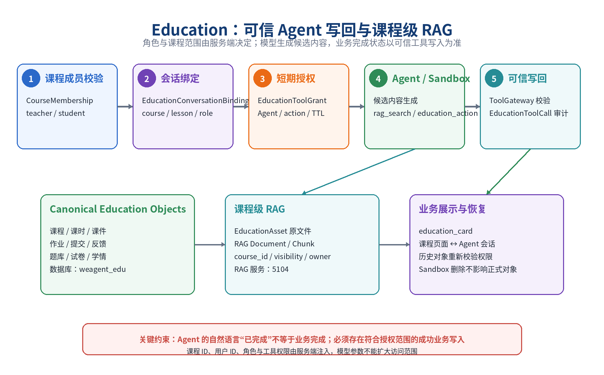

**图 10-3　Education 可信 Agent 写回与课程级 RAG**

#### 10.3.1 课程与角色

主要基础对象包括：

- `Course`：课程；
- `CourseMembership`：课程成员与教师/学生角色；
- `CourseMemberProfile`：成员课程画像；
- `CourseInvitation`：课程邀请。

Education 不依赖前端手工切换“教师/学生模式”作为权限事实。每次需要执行受保护操作时，服务会重新解析当前课程成员关系；会话中的角色快照主要用于 UI 和审计。

#### 10.3.2 教学内容与作业闭环

Education 的内容体系包括：

- `CourseUnit`、`Lesson` 和 `LessonActivity`；
- `EducationContent` 与版本，用于教案、课件等结构化内容；
- `EducationMaterial` 与上传资产；
- `Assignment`、内容版本、导入任务；
- `Submission`、SubmissionVersion；
- `ReviewDraft`、分析、Feedback 和 LearningEvent。

发布动作与版本对象分离，使教案、课件和作业能够保留历史版本，而不是直接覆盖当前内容。

#### 10.3.3 知识、测评与学情

知识和学习模块包括：

- 题目、题目版本和答案版本；
- 试卷、试卷版本和 Stimulus；
- `KnowledgeResource`；
- 模拟考试记录；
- 弱点分析快照；
- 课程思维导图及版本；
- `StudentInsightSnapshot` 和成绩概览。

这些对象属于正式 Education 业务数据库。RAG 负责课程资料的文档检索，但不会替代题库、作业、提交和学情等结构化对象。

#### 10.3.4 EducationConversationBinding

`EducationConversationBinding` 把 Core 的 `conversation_id` 持久关联到：

- `actor_user_id`；
- `course_id`；
- 可选 `lesson_id`；
- `membership_role_snapshot`；
- `material_policy`；
- 每个 Education Agent 的 `agent_service_views`；
- `source_route`；
- 绑定状态。

它解决“聊天上下文属于哪门课、哪个课时、由什么角色发起”的恢复问题。即使 Sandbox 被重建，Core 会话与课程业务关系仍可以通过 Binding 重新建立。

#### 10.3.5 可信 Education Agent

`backend/services/edu/agent_policy.py` 当前定义 9 个系统 Agent：

| ID | Agent | 角色 | 服务范围 |
|---|---|---|---|
| `_edu_1` | 课程设计师 | 教师 | `edu`，可选 `rag` |
| `_edu_2` | 课件制作师 | 教师 | `edu`，可选 `rag` |
| `_edu_3` | 习题生成器 | 教师 | `edu`，可选 `rag` |
| `_edu_4` | 学情分析师 | 教师 | `edu` |
| `_edu_5` | 学习规划师 | 学生 | `edu` |
| `_edu_6` | 练习教练 | 学生 | `edu` |
| `_edu_7` | 笔记整理师 | 学生 | `edu`，可选 `rag` |
| `_edu_8` | 资料研究员 | 教师 | `edu + rag` |
| `_edu_9` | 教学审校员 | 教师 | `edu` |

服务范围由 Agent Manifest、当前角色、材料策略和 RAG 开关共同计算。Education Agent 不会因为同一会话中其他 Agent 拥有某个服务，就自动获得相同权限。

#### 10.3.6 RunGrant 和可信写回

Education 写入操作使用短期 `EducationToolGrant`，绑定用户、课程、角色、Agent、允许动作、会话和有效期。`EducationToolCall` 记录实际工具调用和结果。

可信写回链路为：

```text
用户自然语言意图
→ Education 上下文与角色校验
→ Agent 在 Sandbox 生成候选内容
→ education_action
→ ToolGateway 校验 RunGrant / Agent / action / 幂等键
→ 写入正式 Education Object
→ EducationToolCall 审计
→ 构建 education_card
→ 前端展示和业务页恢复
```

因此，模型只在自然语言中声称“保存完成”不能成为业务成功依据。正式完成应对应合法的业务写入和可审计调用。

#### 10.3.7 课程级 RAG

Education 上传的 PDF、Word、文本或其他允许文件先保存为 Education Asset，再进行文档抽取和 RAG ingestion。RAG 文档会携带课程/工作空间、可见范围和所有者等元数据。

教师和学生的检索范围不同。Core 为 Education Sandbox 注入可信 RAG Scope，课程 ID 和角色从服务端上下文获得，模型不能通过传入另一个 `course_id` 绕过范围限制。

#### 10.3.8 正式文件与 Sandbox 的关系

课件等复杂产物可以先在 Agent 私有工作区生成候选文件，再由领域服务读取、校验并写入正式业务对象。Sandbox 文件是生成过程的一部分，不是课程业务事实本身。

### 10.4 Office 智慧办公

Office 服务入口为 `backend/services/office/app.py`，默认端口 `5103`，默认数据库 `weagent_office`。Office 以 Core Workspace 为协作边界，并在领域数据库中保存组织成员、会议、日程、公文、模板、审批、签收和通知。

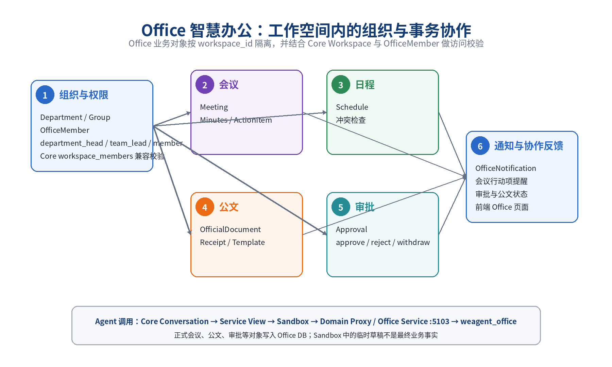

**图 10-4　Office 智慧办公业务流**

#### 10.4.1 组织和访问控制

Office 使用两层信息共同判断访问范围：

1. Core 数据库中的 `workspaces` / `workspace_members`；
2. Office 数据库中的 `OfficeMember`、Department 和 Group。

`OrganizationService.can_access()` 会检查 Workspace 是否属于 Office 领域且处于 active 状态，并接受 Workspace Owner、Core `workspace_members` 或兼容的 OfficeMember 作为访问依据。

Office 角色主要包括：

- `department_head`：部门负责人；
- `team_lead`：小组负责人；
- `member`：普通成员。

组织初始化和部分成员管理操作具有更高权限要求。

#### 10.4.2 会议与行动项

`Meeting` 保存 Workspace 内的会议记录；会议完成后可以保存纪要和决议，并生成 `ActionItem`。行动项与负责人、状态和截止时间关联，可继续进入日程或通知链路。

相关入口位于：

- `/api/office/meetings`；
- `/api/office/meetings/<meeting_id>/minutes`；
- `/api/office/meetings/<meeting_id>/action-items`。

#### 10.4.3 日程与冲突检查

`Schedule` 保存个人或团队日程。Schedule Service 提供列表、创建、更新和 `/conflicts` 冲突检测接口，用于在 Workspace 内检查时间安排。

#### 10.4.4 公文、模板和签收

Office 的文档体系包括：

- `OfficialDocument`：公文主体；
- `DocumentTemplate`：可复用模板；
- `DocumentReceipt`：签收状态；
- 从会议生成公文的业务入口；
- submit、publish、confirm-receipt 等状态动作。

公文正文和流程状态属于 Office 正式业务对象，不应只保存在 Agent 生成的临时 DOCX 或 Markdown 中。

#### 10.4.5 审批和通知

`Approval` 支持查询、批准、拒绝和撤回。OfficeNotification 用于向 Workspace 成员提供组织变更、会议行动项和业务状态通知。

Agent 查询会议、公文、审批等数据时，可以返回 `office_card` 结构化消息元素。涉及创建、修改、提交、发布或审批等具有业务影响的写操作，运行提示会要求先向用户明确影响范围。

### 10.5 共享 RAG 服务

RAG 服务位于 `backend/services/rag/`，默认端口 `5104`。它不是第四个业务领域，而是为多个领域提供文档知识能力的共享服务。

当前关键能力包括：

- 文件上传与文档列表；
- URL Fetch 和受控网页抓取；
- 文档 Preview、Confirm、Reprocess 和 Delete；
- 文本切块和来源位置记录；
- Embedding；
- 语义检索；
- 语义 + 关键词混合检索；
- `SearchScope` 访问范围；
- 文档处理状态查询。

当前向量实现是 SQLite `SimpleVectorStore`，使用 brute-force cosine similarity。配置文件中的 ChromaDB 和 Milvus 地址仍是候选配置，不代表现行向量后端。

对于长期扩展，RAG 的核心契约应保持在 Document / Chunk / Embedding / SearchScope 层，底层 Vector Store 可以后续替换，而不要求修改三个领域的业务模型。

### 10.6 三个领域的实现差异

| 维度 | RD | Education | Office |
|---|---|---|---|
| 业务主边界 | Workspace → Project | Course / Membership + Education Binding | Workspace + Organization |
| 主要对象 | 项目、迭代、需求、Bug、仓库、Review、Build | 课程、课时、课件、作业、提交、知识、测评、学情 | 组织、会议、行动项、日程、公文、模板、审批 |
| 独立数据库 | `weagent_rd` | `weagent_edu` | `weagent_office` |
| 外部集成 | GitHub / GitHub Actions | 教学资料、课程 RAG、可选公开资料检索 | 组织和办公业务对象，当前以内部服务为主 |
| Agent 接入 | 通用 Service View + RD API | 专用 Agent Policy + RunGrant + `education_action` | 通用 Service View + Office API |
| RAG 范围 | Workspace / 项目资料 | 课程、角色、可见性 | Workspace / 办公资料 |
| 正式写回判定 | RD API 成功写入 | 可信工具和审计调用成功 | Office API 成功写入 |
| 前端主入口 | `/projects`、`/repos`、`/reviews`、`/builds` | `/education/*` | `/documents`、`/meetings`、`/approvals`、`/schedules` 等 |

### 10.7 新领域扩展原则

如果后续增加新的业务领域，建议复用现有边界，而不是把业务逻辑直接写入 Conversation 或 Sandbox：

1. 在 Core Workspace 中增加明确的领域标识；
2. 建立独立领域服务和权威业务数据存储；
3. 提供 `/api/<domain>/spec` 或等价服务契约；
4. 通过 Domain Proxy 和 Service View 接入 Agent；
5. 明确领域角色和访问范围；
6. 需要 RAG 时，把 domain/workspace/owner/visibility 纳入服务端 Scope；
7. 高风险写操作使用可审计、可幂等的业务写入协议；
8. Sandbox 只作为执行环境，不作为正式业务事实存储。

---

## 11. 关键术语表

本章统一技术文档中的主要术语。术语解释以当前工程语义为准，不将产品宣传概念与代码对象混用。

| 术语 | 解释 |
|---|---|
| WeAgent Core | 通用 Flask 控制面，负责认证、Workspace、Conversation、Message、Agent、Capability、Domain Proxy、Socket.IO 和 Sandbox Host。 |
| Workspace | Core 中的领域工作空间，使用 `domain=rd/edu/office` 组织会话和业务上下文。 |
| Domain | 研发、教育、办公等业务边界。当前正式领域为 `rd`、`edu`、`office`。 |
| Domain Service | 独立运行的领域业务服务，如 RD、Education、Office。 |
| Domain Proxy | Core 的领域 API 网关，将 `/api/domain/<domain>/*` 转发到对应服务。 |
| Service Spec | 领域服务提供给 Core/Agent 的能力和接口自描述，如 `/api/rd/spec`。 |
| Service Registry | 注入 Sandbox 的服务名与 Base URL 映射。 |
| Service View / Agent Service View | 某个会话或 Agent 当前被允许发现、调用的服务集合。 |
| Agent | WeAgent 中承担任务的 AI 工作角色，对应平台 Agent 配置和 Sandbox 运行上下文。 |
| Moderator | 多 Agent 会话中的主持 Agent，负责计划、分派和汇总。 |
| Worker | 执行主持 Agent 分配子任务的 Agent。 |
| Provider Adapter | Agent 选择底层 AI Coding 引擎的配置机制。 |
| Provider Runner | Sandbox 中封装 Claude Code、Codex、OpenCode CLI 的统一运行器。 |
| Docker Sandbox | 隔离 Agent 文件、工具、命令和预览服务的容器执行环境。 |
| Sandbox Session | Host Manager 用于管理某个会话 Docker 生命周期的 session。 |
| Container Server | Sandbox 容器内部 HTTP 控制面。 |
| Orchestrator | 容器内组织 AgentRuntime、工具、服务和执行链的调度组件。 |
| AgentRuntime | 单个 Agent 的容器运行上下文，负责工作目录、提示词、Runner 和输出采集。 |
| Capability | Skill、Tool、MCP、Plugin 的统一平台能力抽象。 |
| Capability Version | Capability 的不可变版本，包含 manifest、资产、权限和校验信息。 |
| Capability Projection | 把当前 Agent 可用能力写入 `/workspace/.weagent/*` 的过程。 |
| MCP Runtime | 容器内启动、发现和调用 MCP Server 工具的运行时。 |
| ToolProviderConfig | 某个工具连接外部 Provider 时使用的用户级配置，不等同于 Agent Adapter。 |
| Conversation | Core 会话对象，保存 Workspace、领域、参与者和 Sandbox 绑定等上下文。 |
| Message | 用户或 Agent 消息对象，包含正文、状态、结构化元素和 Raw Output。 |
| AgentRun | 一个 Agent 在某一轮任务中的执行记录。 |
| Message Element | `Message.elements` 中的结构化展示单元，例如 progress、file、table、service、workflow、领域卡片。 |
| Raw Output | `Message.raw_output` 中保存的底层 Provider / Sandbox 原始输出，用于排查和恢复。 |
| Artifact | Core 中部分可复用产物记录；不是所有运行时产物的统一存储。 |
| Artifact Workbench | 客户端用于查看、编辑代码、HTML、图片、表格和 Diff 等产物的工作台。 |
| Service Proxy | Core 将 Sandbox 内服务暴露为受控预览入口的代理机制。 |
| `weagent-report` | Sandbox 内向结构化事件系统上报进度、结果和产物的命令。 |
| `weagent-service` | Sandbox 内管理长运行预览服务的命令。 |
| Business Fact | 已写入 Core 或领域权威存储、可以恢复和审计的正式业务对象。 |
| Temporary Workspace | Sandbox `/workspace` 下的执行文件，默认属于临时运行状态，不天然是正式业务事实。 |
| RAG | Retrieval-Augmented Generation；WeAgent 中指独立的文档解析、Chunk、Embedding、检索和访问范围服务。 |
| Document | RAG 中的文档元数据对象，记录来源、领域、Workspace、所有者、可见性和处理状态。 |
| Chunk | RAG 文档切分后的检索单元，记录文本和来源位置。 |
| Embedding | 将文本转换为向量表示的过程。 |
| SimpleVectorStore | 当前 RAG 实际使用的 SQLite 向量存储实现。 |
| Hybrid Search | 将语义相似度和关键词结果结合的混合检索。 |
| RAG Scope | 服务端生成的检索范围，包括 user/domain/workspace/role/document whitelist 等约束。 |
| RD | 智能研发领域，服务端口 5101，业务数据库 `weagent_rd`。 |
| RdProject | RD 的项目主对象，通过 `workspace_id` 关联 Core Workspace。 |
| RdRepo | RD 保存的 GitHub 仓库元数据对象，不复制完整代码仓库。 |
| Review | RD 中的代码审查记录和问题集合。 |
| Build | RD 中的构建记录，可与 GitHub Actions Run 和 Artifact 关联。 |
| Education | 智慧教育领域，服务端口 5102，业务数据库 `weagent_edu`。 |
| CourseMembership | Education 的课程成员和教师/学生角色事实来源。 |
| EducationConversationBinding | Core Conversation 与 Education 课程、课时、角色快照和服务视角之间的持久绑定。 |
| Education Agent | `agent_policy.py` 中定义的受信系统教育 Agent。 |
| RunGrant / EducationToolGrant | Education 服务签发的短期工具授权，绑定用户、课程、角色、Agent、动作和有效期。 |
| EducationToolCall | Education 可信工具调用的审计记录。 |
| `education_action` | Education 业务写入和受控敏感动作的专用 Agent 工具。 |
| Canonical Education Object | 已由 Education 服务合法写入数据库的课程、课件、作业、学情等正式对象。 |
| `education_card` | 从合法业务结果构建的 Education 消息卡片，并在后续读取时重新校验权限。 |
| Office | 智慧办公领域，服务端口 5103，业务数据库 `weagent_office`。 |
| OfficeMember | Office 领域成员对象，与 Core Workspace Member 共同参与访问校验。 |
| Meeting / ActionItem | Office 会议和会后行动项对象。 |
| OfficialDocument | Office 正式公文对象。 |
| DocumentReceipt | Office 公文签收记录。 |
| Approval | Office 审批对象，支持批准、拒绝和撤回等动作。 |
| Grayscale | Core 的领域功能开关和灰度控制机制。 |
